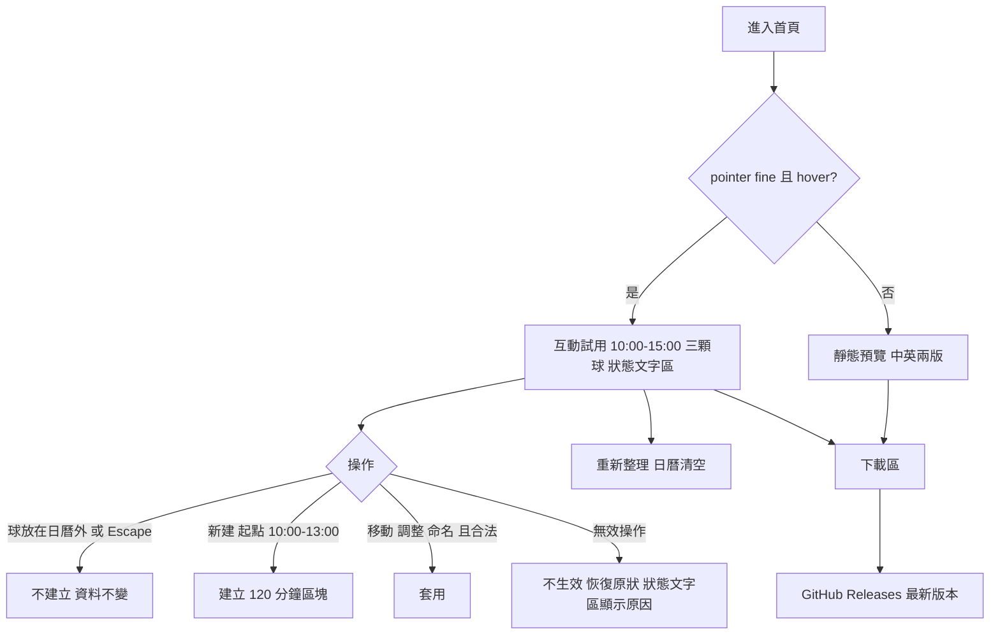

# 03 SRS — Juicy Landing Page

| 項目 | 內容 |
|---|---|
| 版本／狀態 | v0.2 **草稿**（待專案擁有者審查；未經審查前不進入設計） |
| 負責人／審查者 | 專案擁有者（使用者） |
| 日期 | 2026-11-09 |
| 上游 | `docs/02-prd.md` v0.3（草稿；現行 10 條 AC：AC-01.1、01.2、01.3、01.4、01.6、01.7、02.1、02.2、03.1、03.2；AC-01.5 已併入 AC-01.4，編號不重用） |
| 沿用 Calendar 的行為 | 標「沿用 Calendar」的規則，來源是 `juicy-calendar` 文件與原始碼（2026-11-09 閱讀），**尚未在網頁試用中驗證**，驗證前不視為已確認 |

## 功能需求

共 10 條，每條都引用 AC。拒絕時資料是否改變寫在同一格。「無效操作」的定義見下方規則字典。

| ID | 可觀察的系統行為 | 來源 AC |
|---|---|---|
| FR-01 | 在可互動的環境，試用區載入時顯示空日曆，時間軸只顯示 10:00–15:00，側邊顯示三顆球：專注／藍、休息／綠、雜事／橘，每顆都有文字名稱；試用區內有一個固定位置的狀態文字區。 | AC-01.1 |
| FR-02 | 把球拖到日曆上放開，起點在 10:00 到 13:00 之間且對齊 30 分鐘單位 → 建立 120 分鐘區塊，顏色等於該球，球仍留在側邊可再次使用。起點不在此範圍 → 無效操作：不建立區塊，資料不變，狀態文字區顯示原因。 | AC-01.1、AC-01.3 |
| FR-03 | 拖曳區塊邊緣調整長度，以 30 分鐘為單位 → 結果長度 ≥ 30 分鐘且完整位於 10:00–15:00 內時套用。長度不足 30 分鐘、終點不晚於起點、或超出 10:00–15:00 → 無效操作：恢復操作前的位置與長度，不自動截斷或修正，狀態文字區顯示原因。 | AC-01.1、AC-01.3 |
| FR-04 | 拖曳區塊本體移動，以 30 分鐘為單位，長度不變 → 新位置完整位於 10:00–15:00 內時套用（「最晚起始 13:00」不適用，30 分鐘區塊可移到 14:30–15:00）。超出時間窗 → 無效操作：恢復操作前的位置，狀態文字區顯示原因。 | AC-01.7、AC-01.3 |
| FR-05 | 雙擊區塊進入命名，輸入名稱並按 Enter → 名稱被儲存並顯示在區塊上。名稱清空或只剩空白 → 無效操作：保持原名稱，資料不變，狀態文字區顯示原因。 | AC-01.1、AC-01.3 |
| FR-06 | 拖球途中在日曆以外放開，或按 Escape → 不建立任何區塊，日曆上的區塊數不變，球仍可再次拖曳。 | AC-01.2 |
| FR-07 | 試用資料只屬於目前分頁：重新整理 → 日曆回到空的狀態、沒有區塊、三顆球仍可用；另一個分頁看不到這個分頁的區塊。操作試用時沒有任何網路請求攜帶區塊內容（名稱、時間），試用區附近顯示「試用內容不會上傳，重新整理頁面就會消失」。整個網站載入時沒有跨站追蹤、沒有識別個人的 cookie、沒有廣告請求；頁面說明使用哪種流量統計、收集什麼（含語言偏好存在訪客自己的瀏覽器），並說明桌面 App 離線、無遙測。 | AC-01.4、AC-03.2 |
| FR-08 | 主要輸入同時符合 `pointer: fine` 與 `hover: hover` → 開放互動試用；不符合 → 試用區改顯示不能拖曳或點擊的靜態預覽圖（實際試用介面的截圖：10:00–15:00 日曆、三顆球、一個 10:00–12:00 區塊）、圖下說明文字、「產品預覽」標示。圖、替代文字與圖下說明都有中英兩版，隨網站語言切換。靜態環境不建立區塊、不產生資料，Windows 下載區照常顯示。判定只看這兩項，不看裝置名稱、作業系統或螢幕寬度。 | AC-01.6 |
| FR-09 | 下載區位於試用區下方、在同一頁。主按鈕「下載 Windows 版」→ 前往 Juicy Calendar 的 GitHub Releases 最新版本頁；免安裝 .zip 與原始碼連結也在下載區內。下載區同時顯示：僅支援 Windows 10 1803 以上 64 位元、需要 WebView2、安裝檔未簽章與 SmartScreen 警告的處理方式、網頁試用為瀏覽器版（與桌面版有差異）、桌面 App 離線且無帳號。所有訪客（任何作業系統、任何互動判定結果）看到相同的下載區。 | AC-02.1、AC-02.2 |
| FR-10 | 語言：訪客沒有手動選過 → 瀏覽器語言為繁體或簡體中文（任何中文地區）時顯示繁體中文，其他語言顯示英文；訪客手動切換 → 整頁（含試用區介面文字、狀態文字區訊息、靜態預覽圖與說明）立即變成所選語言，且選擇在目前瀏覽器重新整理後保留；訪客清除網站資料後 → 回到依瀏覽器語言決定。語言偏好不含任何試用內容，也不影響試用資料。 | AC-03.1 |

**v0.1 到 v0.2 的 FR 編號對照**（編號不重用，變更留痕）：舊 FR-01、02、03 內容拆分並更新為新 FR-01 到 FR-05；舊 FR-05 為新 FR-06；舊 FR-06 與舊 FR-10 的隱私部分合併為新 FR-07；舊 FR-07 為新 FR-08；舊 FR-08 為新 FR-09；舊 FR-09 為新 FR-10。v0.1 未經審查，因此直接整理編號；v0.2 起編號固定。

## 規則與資料字典

這些規則決定試用在邊界上怎麼判斷。時間窗、單位與長度是核心；其餘規則決定狀態誰說了算、資料能不能互相影響。

### 時間窗、單位與長度（FR-01～FR-04）

- **時間窗**：固定 10:00–15:00，本地時間（瀏覽器時區，沿用 Calendar「以本地時間顯示」）。使用者不能改。
- **單位**：建立、移動、調整長度都以 30 分鐘為單位（專案擁有者 2026-11-09 核准）。因此起點與終點只會落在 :00 或 :30。
- **指標位置如何對到單位**（例如指標落在 10:44，算 10:30 還是 11:00）：**未決**，見 OR-01。
- **新區塊**：初始長度 120 分鐘；起點 10:00 到 13:00；最晚起始 13:00。
- **既有區塊**：長度 ≥ 30 分鐘；必須完整位於 10:00–15:00（起點 ≥ 10:00，終點 ≤ 15:00，終點晚於起點）。**最晚起始 13:00 只適用新建，不適用移動或調整既有區塊。**
- **無效操作**：長度不足 30 分鐘、終點不晚於起點、超出時間窗，都無效。無效操作不生效，不自動截斷或修正：新建 → 不建立；移動或調整 → 恢復操作前的位置與長度。

**決策表**

| 動作 | 條件 | 結果 |
|---|---|---|
| 新建 | 起點在 10:00、10:30、…、13:00 | 建立 120 分鐘區塊 |
| 新建 | 起點晚於 13:00（例如 13:30、14:00）或早於 10:00 | 無效：不建立，顯示原因 |
| 移動 | 新起點 ≥ 10:00 且新終點 ≤ 15:00（長度不變） | 套用 |
| 移動 | 新終點 > 15:00 或新起點 < 10:00 | 無效：恢復原位，顯示原因 |
| 調整長度 | 新長度 ≥ 30 分鐘，起點 ≥ 10:00，終點 ≤ 15:00 | 套用 |
| 調整長度 | 新長度 < 30 分鐘、終點不晚於起點、或超出時間窗 | 無效：恢復原位與原長度，顯示原因 |
| 命名 | 名稱去除空白後不為空 | 儲存 |
| 命名 | 名稱為空或只含空白 | 無效：保持原名稱，顯示原因 |

**邊界例子**（起點、終點為本地時間；AC 編號是該例子的出處）

| 動作 | 起 | 迄 | 判定 |
|---|---|---|---|
| 新建 | 10:00 | 12:00 | 合法（AC-01.6 靜態圖中的區塊） |
| 新建 | 10:30 | 12:30 | 合法（AC-01.1 起手） |
| 新建 | 13:00 | 15:00 | 合法（最晚起點，剛好貼齊） |
| 新建 | 13:30 | 15:30 | 無效：超出 15:00（AC-01.3a） |
| 新建 | 09:30 | 11:30 | 無效：早於 10:00 |
| 調整終點 | 10:30 | 13:00 | 合法（AC-01.1 結果，150 分鐘） |
| 調整終點 | 10:30 | 15:30 | 無效：超出 15:00（AC-01.3b） |
| 調整終點 | 10:00 | 10:00（原 10:00–10:30） | 無效：終點不晚於起點，長度不足（AC-01.3c） |
| 調整起點 | 10:00 | 09:30 | 無效：早於 10:00 |
| 縮短 | 10:00–12:00 | 10:00–10:30 | 合法（30 分鐘，下限）（AC-01.7 前置） |
| 移動 | 10:00–12:00 | 13:00–15:00 | 合法（貼齊 15:00） |
| 移動 | 10:00–12:00 | 13:30–15:30 | 無效：超出 15:00（AC-01.3d） |
| 移動 | 10:00–10:30（縮短後） | 14:30–15:00 | 合法（AC-01.7；證明 13:00 限制不適用移動） |
| 移動 | 10:00–10:30 | 15:00–15:30 | 無效：超出 15:00 |

### 球（FR-01、FR-02）

- 固定三顆：專注／藍、休息／綠、雜事／橘；每顆必須有文字名稱，兩種語言各有一個名稱。
- 色碼與英文名稱**未決**，見 OR-12。這三顆是新設定，不沿用 Calendar 現有六顆英文球。
- 球使用不會耗盡；區塊顏色等於放置它的球的顏色。

### 狀態文字區（FR-01～FR-05）

- 試用區內固定位置的文字區，拒絕操作時顯示該次被拒絕的**具體原因**，不只用顏色提示。
- 每則訊息都有中文與英文，一一對應；語言跟隨網站目前語言。
- 訊息確切文字、顯示時機與清除時機、是否讓輔助技術朗讀、短時間連續多次拒絕時怎麼顯示：**未決**，見 OR-13。

### 名稱（FR-05）

- **必填**：是。名稱不可為空，也不可只含空白。
- **無效時**：還原原名稱，資料不變，並在狀態文字區顯示原因（專案擁有者 2026-11-09 核准，取代原先沿用 Calendar 的「不顯示訊息」）。
- **上限**：PRD 未規定。Calendar 的上限是 30 個使用者看到的字元；試用是否沿用，**未決**（OR-05）。
- **新區塊的初始名稱**：PRD 未規定（OR-05）。

### 取消（FR-06）

- 拖曳中放開位置在日曆以外，或按 Escape → 不建立區塊。
- 這兩種取消是否也在狀態文字區顯示原因：**未決**（OR-15）。目前不要求。放在日曆外時的碎片消散等動畫，沿用 Calendar，PRD 不要求，不列為需求。

### 狀態由誰決定

| 狀態 | 由誰決定 | 備註 |
|---|---|---|
| 日曆上的區塊集合 | 訪客在目前這個分頁的操作 | 只存在這個分頁的記憶體；沒有伺服器端狀態 |
| 目前語言 | 先看訪客手動選擇（若有保存）；否則依瀏覽器語言規則；不支援的語言用英文 | 瀏覽器語言有多個候選時取哪一個，**未決**（OR-08） |
| 是否開放互動 | 瀏覽器回報的主要輸入能力：同時符合 `pointer: fine` 與 `hover: hover` | 不符合（含瀏覽器不支援這兩項查詢）即顯示靜態預覽。動態更換輸入裝置時是否重新判定，**未決**（OR-04） |
| 下載目標的版本 | GitHub Releases 的「最新版本」 | 本站只提供連結，不決定版本；前提是 Releases 有可下載的 Windows 檔（Brief A-05） |
| 區塊顏色 | 放置它的球 | 之後不會因球的設定變動而改變（沿用 Calendar：編輯區塊不影響模板） |

### 資料隔離（FR-07、FR-10）

- **試用資料**只屬於目前分頁，不寫入任何持久儲存，分頁之間不共享，重新整理即清除（專案擁有者 2026-11-09 核准）。
- **語言偏好**只保存訪客手動選擇的結果，存在訪客自己的瀏覽器，不上傳；它與試用資料互相獨立：重新整理清除試用資料不影響語言，語言選擇不含任何試用內容。保存機制與期限留到設計階段（OR-09）。
- **流量統計**：若記錄事件，內容不得包含區塊名稱或時間。統計工具未選（D-03），「開始試用」的定義未決（OR-10）。
- **下載連結**只是導向，不傳遞任何試用資料。

## 品質需求

- **NFR-01｜隱私**：在測試環境完整走一遍試用流程（建立、調整、移動、命名、被拒絕的操作、重新整理），用開發者工具的網路面板與 cookie 面板檢查，沒有任何請求含區塊名稱或時間；沒有跨站追蹤與廣告請求；沒有識別個人的 cookie。驗證：上線前人工檢查，可附自動化檢查。
- **NFR-02｜語言完整**：兩種語言的文字集合沒有缺漏，包含介面、狀態文字區訊息、靜態預覽的圖、替代文字與圖下說明；切換後整頁可見文字沒有殘留另一種語言（Juicy、Windows 等專有名稱不算）。驗證：字串完整性檢查加人工瀏覽；靜態預覽圖在兩種語言下各檢查一次。
- **NFR-03｜資訊真實**：下載區每一項敘述都能對到 Calendar 文件的來源，沒有未驗證的功能或平台宣稱。驗證：人工逐條對照；上線前重新核對 Calendar 最新文件。
- **NFR-04｜響應式**：在桌機寬度與手機寬度各檢查一次，頁面沒有水平捲動，下載區可抵達。手機寬度的觸控裝置顯示靜態預覽；桌機接滑鼠縮到手機寬度仍可互動（不看寬度）。驗證：手動。具體寬度**待定**，PRD 與 Brief 沒有指定。
- **NFR-05｜效能**：**待量測**。尚無依據可訂門檻，所以不寫數字。建議量測：首頁載入到可互動的時間、拖曳時畫面是否流暢、重用 Calendar 程式碼後的頁面大小。量測方式與環境留到設計與測試計畫。
- **NFR-06｜瀏覽器相容性**：支援哪些瀏覽器與版本，**未決**。Calendar 的自動測試只跑 WebKit，不等於支援範圍。
- **NFR-07｜可近用**：
  - 觀察點：每個被拒絕的情境（AC-01.3 的 (a)～(e)）都出現文字說明，不只靠顏色。驗證：人工逐一觸發並確認；是否讓輔助技術朗讀未決（OR-13）。
  - 已知限制：試用靠指標拖曳，沿用 Calendar 不支援鍵盤拖曳（Calendar NG-07）。沒有精細指標的環境會被判定為靜態預覽；有滑鼠但改用鍵盤操作的訪客會看到互動試用卻無法操作。是否提供替代，**未決**（OR-11）。

## 流程與未決事項

### 矛盾與張力

| ID | 說明 | 狀態 |
|---|---|---|
| X-1 | 切換語言後要求「沒有殘留另一種語言」，但靜態預覽圖原本只有一種語言 | **已解決**：PRD 已核准中英兩版圖與替代文字、圖下說明，隨語言切換（AC-01.6、AC-03.1、FR-08、NFR-02） |
| X-2 | 提案要求拒絕時「說明原因」，但 AC-01.3 與 Calendar 的做法是名稱被拒絕時不顯示訊息 | **已解決**：專案擁有者核准把名稱拒絕改為顯示原因，所有無效操作風格一致（AC-01.3(e)、FR-05）。殘留：AC-01.2 的兩種取消目前不顯示原因，是否有意，見 OR-15 |
| X-3 | AC-01.1 的 10:30 例子，前提是起點粒度至少到 30 分鐘 | **已解決**：粒度定為 30 分鐘，10:30 合法。殘留：指標位置怎麼取整，見 OR-01 |
| X-4 | 靜態圖要「實際試用介面截圖」，但試用區顯示哪些 UI 尚未決定 | **矛盾已消除，依賴仍在**：製作順序已定為「先定義 UI 範圍 → 完成互動版 → 截圖」。UI 範圍本身仍未定，見 OR-14 |

### 仍無法獨立算出預期結果的規則（OR-01～OR-15）

「阻擋層級」說明這項未決會擋住哪個階段：**設計**（SAD、SDS）、**實作**（寫程式與單元測試）、**發布**（上線前必須完成）。理由寫在最右欄。

| ID | 狀態 | 缺什麼 | 阻擋層級 | 決策人 | 理由 |
|---|---|---|---|---|---|
| OR-01 | 部分解決 | 單位已定為 30 分鐘。指標落在兩個單位之間時如何取整（四捨五入、無條件捨去，或對齊最近的格線） | 實作 | 專案擁有者 | 設計不依賴取整方式；但沒有這條，測試者算不出 10:44 放下會落在哪裡 |
| OR-02 | **已解決** | 超出時間窗的處理：無效操作不生效，不自動修正，狀態文字區顯示原因 | — | 專案擁有者 | 2026-11-09 核准；文案另見 OR-13 |
| OR-03 | **已解決** | 最小長度 30 分鐘；長度不足、終點不晚於起點、超出時間窗皆為無效 | — | 專案擁有者 | 2026-11-09 核准 |
| OR-04 | 部分解決 | 判定規則已定（`pointer: fine` 且 `hover: hover`）。動態更換輸入裝置時是否重新判定；若重新判定，切換時已有的區塊如何處理 | 設計 | 專案擁有者 | 決定要不要監聽變化，會影響元件的狀態模型，所以要在設計前定 |
| OR-05 | 未決 | 名稱上限是否沿用 Calendar 的 30 字；新區塊建立時的初始名稱 | 實作 | 專案擁有者 | 設計不依賴；但實作與測試的預期值需要它 |
| OR-06 | 未決 | 試用日曆顯示哪些日期（單日、一週，或其他）；Calendar 的「過去日期降低飽和度」是否出現 | 設計 | 專案擁有者 | 決定日曆視圖結構與可重用的元件；AC-01.1「某一天」也依賴它 |
| OR-07 | 部分解決 | 移動既有區塊的規則已定並寫入 AC-01.7。刪除、復原／重做目前沒有 AC，細節（怎樣算被選取、復原涵蓋哪些操作、步數上限、是否有按鈕）未決；PRD Q-06 方案 A/B/C 待你選 | 設計 | 專案擁有者 | 復原／重做會決定狀態模型（是否需要歷史紀錄）；是否有 AC 也決定 SRS 是否承接 |
| OR-08 | 部分解決 | 不支援的語言用英文已定。瀏覽器語言有多個候選時取哪一個，例如先 `fr` 再 `zh-TW` | 實作 | 專案擁有者 | 設計階段可提案，但取哪一個影響測試預期值 |
| OR-09 | 部分解決 | 保留範圍（目前瀏覽器、重新整理後仍在）與清除後行為已定。儲存機制與期限（例如是否過期）未決 | 設計（屬 SAD 要決定的事，不擋 SAD 開始） | 專案擁有者；設計階段提案 | 這是設計階段的輸入，不是開始前的前提 |
| OR-10 | 未決 | 「開始試用」何時算（首次拖曳、首次建立區塊，或其他）；統計工具是否能記錄事件（D-03） | 實作 | 專案擁有者 | 只影響統計；不影響試用本身 |
| OR-11 | 未決 | 有鍵盤、無法用滑鼠的桌機訪客是否需要替代方案 | 設計 | 專案擁有者 | 若要提供替代操作，會改變互動設計 |
| OR-12 | 未決 | 三顆球的具體色碼與英文名稱 | 實作、發布 | 專案擁有者 | 設計可先用佔位；實作與靜態預覽圖需要確定值，圖必須在發布前完成 |
| OR-13 | 未決 | 狀態文字區：訊息確切文字（中英）、出現與清除時機、是否讓輔助技術朗讀、連續多次拒絕時怎麼顯示 | 設計（出現與清除時機、朗讀）、實作（文字） | 專案擁有者 | 出現與清除時機及輔助技術支援影響元件設計；文字本身只影響實作與翻譯完整性檢查 |
| OR-14 | 未決 | 試用區的 UI 範圍：工具列起訖時間控制項是否隱藏；視圖切換、語言選單、設定是否出現 | 設計、發布 | 專案擁有者 | 決定重用 Calendar 哪些元件（D-08）；也是靜態預覽圖的製作前提，圖要在互動版完成後才能截，所以還擋住發布 |
| OR-15 | 未決 | AC-01.2 的兩種取消（日曆外放開、Escape）是否也在狀態文字區顯示原因。目前不要求，與 AC-01.3 的風格不同 | 實作 | 專案擁有者 | 設計不依賴；但實作與測試需要知道有沒有訊息 |

## Gate：SRS 承接情況與缺口

**AC 對 FR 的承接**：PRD 現行的 10 條 AC 都至少被一條 FR 引用。

| AC | 承接 FR |
|---|---|
| AC-01.1 | FR-01、FR-02、FR-03、FR-05 |
| AC-01.2 | FR-06 |
| AC-01.3 | FR-02、FR-03、FR-04、FR-05 |
| AC-01.4 | FR-07 |
| AC-01.6 | FR-08 |
| AC-01.7 | FR-04 |
| AC-02.1 | FR-09 |
| AC-02.2 | FR-09 |
| AC-03.1 | FR-10 |
| AC-03.2 | FR-07 |

（AC-01.5 已併入 AC-01.4，由 FR-07 承接。）

**PRD 已列入範圍、但沒有 AC 因此 SRS 沒有承接的項目**：
- 刪除區塊、復原／重做（Brief D-05 範圍）：待 PRD Q-06 方案確認。
- 頁尾的授權連結（`LICENSE`、`TRADEMARKS.md`）：待 PRD Q-06 方案確認。

**仍無法獨立算出預期結果的規則**：OR-01、OR-04～OR-15（共 13 項，其中 OR-01、OR-04、OR-07、OR-08、OR-09 為部分解決）。OR-02、OR-03 已解決。

**文件衝突**：SRS 與 PRD 目前一致；PRD 與 Brief 不一致（NG-08、G-06、已決表、D-08），詳見 PRD 文末「與 Brief 的差異」，待你確認是否同步。

> 審查重點：每條 AC 可追到 FR／NFR；需求不互相矛盾；合法、非法、邊界與持久副作用可判定；設計與測試者可獨立算出預期結果。**目前為草稿，建議先處理阻擋設計的 OR-04、OR-06、OR-07、OR-11、OR-13、OR-14，再進入設計。**
