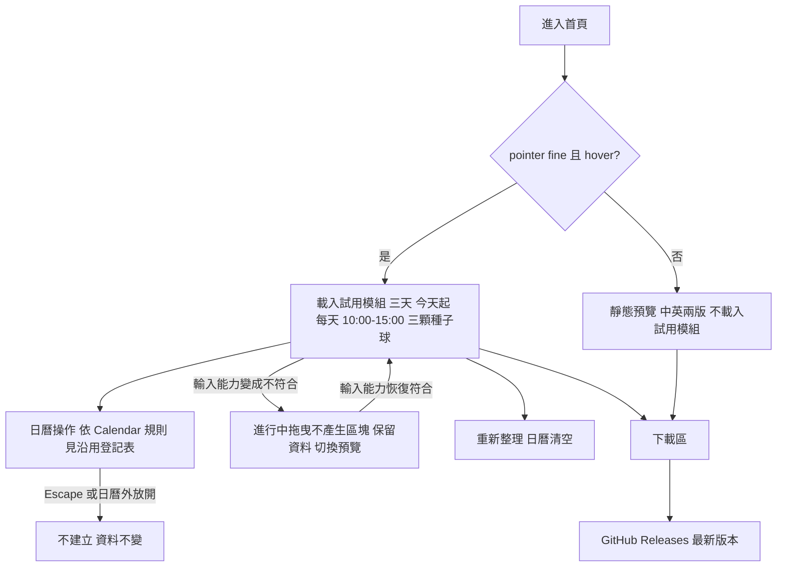

# 03 SRS — Juicy Landing Page

| 項目 | 內容 |
|---|---|
| 版本／狀態 | v0.5 **草稿**（2026-11-11 修訂：試用改為網站自有實作，見「方向」列；待專案擁有者審查） |
| 負責人／審查者 | 專案擁有者（使用者） |
| 日期 | 2026-11-09（初版）、2026-11-11（修訂） |
| 上游 | `docs/02-prd.md` v0.5（草稿；15 條有效 AC：AC-01.1、01.2、01.4、01.6、01.7、01.9、01.10、01.13、01.15、01.16、02.1～02.3、03.1、03.2；AC-01.3、01.8、01.11、01.12、01.14 已撤回，AC-01.5 已併入 AC-01.4，編號皆不重用） |
| 方向（2026-11-09） | 試用的日曆操作**沿用 Juicy Calendar**，不新增 App 沒有的日曆功能；行為與 Calendar 一致，但由網站自己維護一份實作（見下方 2026-11-11 修訂）。網站專屬的 30 分鐘吸附、最小 30 分鐘、最晚起始 13:00、超界拒絕、狀態文字區、鍵盤移動等規則已撤回。**2026-11-11 修訂（專案擁有者決定，取代 Brief D-08 的方案 B）：不修改 Calendar、不新增套件，不依賴共用模組。**「沿用」改指**規則與外觀和 Calendar 固定 commit 一致**，由網站自己實作（`src/trial/`，ADR-03 選 B、ADR-04 選 B）。本輪試用只開放：長按空白處叫出球、把球拖到日曆建立區塊、拖移區塊（含 Escape 或日曆外放開的取消）。調整長度、命名、選取與多選、刪除、復原／重做、右鍵選單、框選、剪貼簿留到使用者下載後體驗，網站不提供 |

## 沿用登記表

這是「網站沿用 Calendar 什麼」的**唯一定義處**。Brief、PRD 與本 SRS 其他段落只引用 `REUSE-nn`，不重述規則。

- **基準**：Calendar v0.2.0-beta.3，完整 commit `102ae1917047aee691e88cef9c497b50df745c41`。下表路徑皆相對該 commit；一律用 `git show 102ae19…:<路徑>` 這類固定 commit 的方式讀取，不讀 Calendar 目前的 HEAD（HEAD 已不同）。
- **「程式碼」欄**：2026-11-09 本專案讀過該 commit 的原始碼為「已查證」；只讀到片段為「部分」；沒讀為「未查」。
- **「測試」欄**：「存在」只表示檔案或案例存在於該 commit；**截至本版，本專案尚未執行過任何 Calendar 測試**，所以所有「測試已執行」皆為「否」。測試內容是否真的涵蓋該行為，除非另註，皆未逐項對照。
- **版本追蹤**：網站沒有共用模組可鎖定版本（2026-11-11）。本表的基準是規則的來源；Calendar 發新版時，由 `npm run check:calendar-release`（每日排程）發現下載連結過期，再由專案擁有者人工比對規則是否改變並更新本表，網站不會自動跟上。
- **開放狀態（2026-11-11）**：本表的規則仍是唯一定義處，但試用只開放其中一部分。**開放**：REUSE-01（磁吸）、02（建立）、03（移動）、05（取消）、11（可見範圍）、12（語言偵測）、13（過去日降飽和）、15（球的形狀）。**部分**：REUSE-06（只有「按下區塊即選取」的外框，Escape 清除選取尚未做）。**暫不開放**：REUSE-04（調整長度）、07（刪除）、08（復原／重做）、09（命名）、10（多選、框選、剪貼簿、右鍵選單）。**不適用**：REUSE-14（網站只有記憶體資料，沒有儲存介面）。
- **修訂註記（證據更正，2026-11-09，專案擁有者核准）**：下表來源路徑補上 `src/features/…`、`src/…` 前綴（原寫法省略前綴，在基準 commit 無法直接 `git show`），已逐一核對路徑在基準 commit 存在；REUSE-09 的行號與測試描述依唯讀查證更正（見 `docs/06-test-plan.md`「Calendar 基準查證記錄」）。**只更正證據，未改需求，未執行任何 Calendar 測試。** 除 REUSE-09 外，各列的行號沒有逐一重新核對。
- **修訂註記（OR-25 重新搜尋）**：本版重新搜尋 Calendar 的測試，更正先前把「未見」寫得過於肯定的列。本表的「未找到」一律表示「本次以所列樣式搜尋未找到」，**不等於確定沒有**；搜尋範圍是該 commit 的 `src/**/*.test.ts` 與 `e2e/*.ts`，樣式見各列。

| ID | 沿用的行為 | 來源 | 程式碼 | 測試 |
|---|---|---|---|---|
| REUSE-01 | 指標位置轉為時間：先換成相對可見範圍起點的分鐘數（可為小數）。磁吸預設開啟（`magnetEnabled` 預設 `true`）時，離最近半點刻度線 ≤ 8 螢幕像素（`abs(最近半點 − 分鐘) × pixelsPerMinute ≤ 8`；預設每分鐘 1 像素，即 ≤ 8 分鐘）就吸附到該半點；否則不吸附，時間取整分鐘（`Math.round`，.5 進位）。磁吸套用於：建立（球放開的位置）、移動（新起點邊緣 = 指標時間 − 抓取偏移）、調整長度（被拖曳的邊緣）、貼上。移動與調整長度的邊緣先由指標換成整分鐘再判斷磁吸，門檻邊緣可能差約 0.5 分鐘。網站不開放設定頁，磁吸與縮放維持預設 | `src/features/calendar/engine/pointer.ts#pointerToTime,magnetMinutes`；`src/features/calendar/engine/timeline.ts#columnMinutesToDate`；`src/features/templates/hooks/useTemplateDrag.ts:42`；`src/features/calendar/hooks/useEventInteractions.ts:85`；`src/features/calendar/components/CalendarGrid.tsx:235`；`src/features/calendar/hooks/useKeyboardShortcuts.ts:68`；`src/services/persistence/schemas.ts#DEFAULT_SETTINGS` | 已查證 | 存在：`e2e/core.spec.ts:612`（磁吸開：10:26 → 10:30；關閉：保留 10:26）、`e2e/core.spec.ts:165`（磁吸關時移動不吸附）。恰好 8 與 9 像素的門檻邊界值：本次搜尋 `magnet`、`8` 相關案例未找到 |
| REUSE-02 | 建立：把球拖到日曆放開，起點取指標時間（受 REUSE-01），長度 120 分鐘，標題複製球名稱，顏色為球色；球不會用完。拖曳中指標被夾在可見範圍內（只有調整長度允許超出） | `src/features/calendar/engine/limits.ts#NEW_EVENT_MINUTES`；`src/features/calendar/engine/mutations.ts#newEventTimes`；`src/stores/appStore.ts#createEventFromTemplate`；`src/features/templates/hooks/useTemplateDrag.ts:42-53` | 已查證 | 存在：`e2e/core.spec.ts:110`（落在 10:30 建立 10:30–12:30、120 分鐘、球保留）、`src/stores/appStore.test.ts:23`（120 分鐘，與球預設長度無關） |
| REUSE-03 | 移動：新起點 = 指標時間 − 抓取偏移，再套用 REUSE-01 的磁吸；長度不變；移動時指標被夾在可見範圍內；沒有拒絕訊息 | `src/features/calendar/engine/mutations.ts#moveEvent`；`src/features/calendar/hooks/useEventInteractions.ts:69-70,85-86` | 已查證 | 存在：`e2e/core.spec.ts:165`（保留長度；該案例先關閉磁吸）、`:342`（捲動後移動仍正確）、`:205`（Escape 取消移動） |
| REUSE-04 | 調整長度：最小 1 分鐘、最大 10080 分鐘（超過時夾住）；被拖曳的邊緣套用 REUSE-01 的磁吸；調整邊緣時指標可超出可見範圍 | `src/features/calendar/engine/limits.ts`；`src/features/calendar/engine/mutations.ts#resizeStart,resizeEnd`；`useEventInteractions.ts:69-70,85` | 已查證 | 存在：`src/features/calendar/engine/resizeBounds.test.ts`、`e2e/core.spec.ts:179,779,790` |
| REUSE-05 | 取消：拖曳中按 Escape，或在日曆外放開，不建立區塊；一次手勢是一個復原步驟（草稿在 hook 本地狀態，commit 時才進 store）；移動與調整長度的 hook 在元件卸載時會停止進行中的手勢（`useEffect(() => () => stopRef.current?.(), [])`） | `src/features/calendar/hooks/useEventInteractions.ts:51,153`；Calendar `ARCHITECTURE.md`「Interaction model」；Calendar `docs/02-prd.md` AC-01.2 | 已查證（球拖曳的卸載清理只讀到 `stopLoop` 與視窗 blur 處理，部分） | 存在：`e2e/core.spec.ts:121`（日曆外放開或 Escape 不建立）、`:205`、`:391`（一手勢一步）、`:604`（無效放開後可重試）、`:624`（拖曳離開視窗取消） |
| REUSE-06 | 選取：點選區塊選取；無手勢進行時按 Escape 清除選取；選取不進復原歷史；復原／重做後清掉已不存在的選取 | `src/features/calendar/hooks/useKeyboardShortcuts.ts:86`；`src/stores/appStore.ts#select,restore` | 已查證 | 存在：`src/stores/multiSelect.test.ts`、`src/features/calendar/engine/selection.test.ts`（內容未對照） |
| REUSE-07 | 刪除：`Delete` 或 `Backspace` 刪除被選取的區塊（單選或多選），不問確認，一次一步，可復原；沒有選取時不動作；文字輸入欄內不觸發；手勢進行中被擋下 | `src/features/calendar/hooks/useKeyboardShortcuts.ts:46-85`；`src/stores/appStore.ts#deleteEvent,deleteSelected` | 已查證 | 存在：`src/stores/multiSelect.test.ts:129`（store 層：無選取時 `deleteSelected` 不動作、不增加歷史）、`e2e/core.spec.ts:355,439`、`e2e/multiSelect.spec.ts:232`。鍵盤層「無選取時按 Delete」的 e2e：本次搜尋「no selected／nothing selected／without selection／deleteSelected」未找到，不等於沒有 |
| REUSE-08 | 復原／重做：`Ctrl/Cmd+Z`、`Ctrl/Cmd+Shift+Z`；快照式歷史，上限 100 步；復原後完成新操作會清除重做；右鍵空白處選單有復原、重做項目，無歷史時停用 | `src/stores/appStore.ts:8,commit,undo,redo`；`src/features/calendar/components/CalendarGrid.tsx:357-362` | 已查證 | 存在：`src/stores/appStore.test.ts:46`（建立、更新、刪除的復原與重做）、`:68`（新變更清除重做、無變更不佔步）、`e2e/core.spec.ts:355,391`。100 步上限：本次搜尋 `HISTORY_LIMIT`、`101`、`100 steps` 等樣式未找到，不等於沒有 |
| REUSE-09 | 命名：雙擊進入；Enter、失焦或點別處提交；Escape 取消；名稱去前後空白後不可為空，不超過 30 個使用者看到的字元；被拒絕時事件不變、**沒有任何訊息**；內容未變不佔步；輸入中的元件被卸載時，清理函式會提交輸入的名稱（`cancelled` 旗標為真時除外） | `src/features/calendar/components/EventBlock.tsx:28-71`；`src/features/calendar/engine/mutations.ts#validateTitle`；`src/features/calendar/engine/limits.ts#NAME_MAX_CHARS`；`src/stores/appStore.ts#updateEvent` | 已查證 | 存在：`e2e/core.spec.ts:220`（Enter 儲存、Escape 取消）、`:667`（清空或超過 30 字被拒絕，畫面與檔案不變）、`src/stores/nameLimit.test.ts`、`src/features/calendar/engine/validateTitle.test.ts`、`appStore.test.ts:68`；**有效名稱的失焦提交**：`e2e/core.spec.ts:243-245`；右鍵「重新命名」：`e2e/contextMenu.spec.ts`（約 `:91`）。本次搜尋未找到：**無效名稱的失焦提交**、**元件卸載時提交**、無效提交時 `futureLength` 不變的斷言（不等於沒有）。以上皆為「測試存在」，**未執行**。命名輸入欄沒有字數上限屬性（`EventBlock.tsx:52-69`）；命名入口只有雙擊區塊（`EventBlock.tsx:118-121`）與右鍵選單「重新命名」（`CalendarGrid.tsx:355`） |
| REUSE-10 | 多選、框選、剪貼簿（`Ctrl/Cmd+C`、`V`）、右鍵選單 | Calendar `docs/02-prd.md` AC-04.1～04.4、AC-05.1、05.3、AC-07.1～07.3；Calendar `docs/03-srs.md` FR-12～FR-15、FR-18、FR-19；程式碼 `useMarqueeSelect.ts`、`useKeyboardShortcuts.ts`、`CalendarGrid.tsx:357` | 部分 | 存在：`e2e/multiSelect.spec.ts`、`e2e/copyPaste.spec.ts`、`e2e/contextMenu.spec.ts` |
| REUSE-11 | 可見範圍由設定 `startHour`、`endHour` 決定（schema 允許 0–23 與 0–24）；區塊可延伸到範圍外，日欄有隱藏區塊的徽章（i18n 鍵 `grid.hiddenOne`、`grid.hiddenMany`） | `src/services/persistence/schemas.ts:48-49`；`src/features/calendar/engine/timeline.ts#timelineSpanMinutes`；`src/i18n/hiddenEventsTitle.ts` | 部分（徽章畫面行為未逐行確認） | 存在：`e2e/core.spec.ts:300`（可見時段外的區塊計入日標題）、`src/i18n/hiddenEventsTitle.test.ts` |
| REUSE-12 | 語言偵測：語系以 `zh` 開頭 → 繁體中文，其餘 → 英文；桌面先看系統語系，沒有才取 `navigator.languages` 第一項。網站沒有系統語系，取第一項 | `src/i18n/detectLanguage.ts` | 已查證 | 存在：`src/i18n/detectLanguage.test.ts` |
| REUSE-13 | 過去日降低飽和度：區塊所在日對 `now` 為過去日（`differenceInCalendarDays(day, now) < 0`）時用降低飽和度的顏色；`now` 來自 `CalendarGrid` 內部的 `useNow()`（`new Date()`，每 60 秒更新）。網站不修改此規則 | `src/features/calendar/engine/timeline.ts:86`（`isPastDate`）；`src/features/calendar/components/CalendarGrid.tsx:39-45,292`；`EventBlock.tsx` 的 `mutedEventColor` | 已查證 | 存在：`e2e/core.spec.ts:639`（以 Playwright 假時鐘 `page.clock` 驗證跨日後降低飽和度，且不改存檔顏色） |
| REUSE-14 | 儲存介面：`WorkspaceBackend`；`backend` 是模組載入時依 `isTauri()` 決定的常數；`persistenceSync` 把 store 變更寫到 backend；瀏覽器 backend 存 `localStorage`（僅開發與 e2e）；`backend.ts` 靜態 import `@tauri-apps/api/core` | `src/services/persistence/backend.ts:7-25,111`；`src/services/persistence/persistenceSync.ts`；Calendar `ARCHITECTURE.md`「Persistence」 | 已查證 | 存在：`src/services/persistence/browserBackend.test.ts` |
| REUSE-15 | 球的資料形狀：`Template`（id、名稱、顏色、預設長度）；名稱是使用者資料，不翻譯 | `src/types`；`src/services/persistence/repository.ts:140`（預設球） | 部分 | 未查證 |

### 規格分類

| 類別 | 項目 |
|---|---|
| 沿用 Calendar（規則與外觀一致，網站自己實作） | **開放**：建立、移動、取消、磁吸、可見範圍、語言偵測規則、過去日降低飽和度。**暫不開放（留到下載後體驗）**：調整長度、命名、選取與多選、刪除、復原／重做、框選、剪貼簿、右鍵選單（REUSE-04、06～10） |
| 網站刻意設定（展示設定，不改 App 行為） | 三天檢視（2026-11-11 由單日改為三天，不開放到一週）；每天可見範圍 10:00–15:00；第一天 = 初始化時的本地今天；三顆種子球；磁吸維持預設；試用資料只在記憶體 |
| 網站新增（不是日曆功能） | 互動資格判定與靜態預覽、下載區（含下載檔 SHA-256 驗證說明）、網站語言切換與保留、頁尾授權連結、搜尋與分享 metadata、隱私與流量統計說明 |
| 網站不提供 | 工作區管理與檔案存取；日期切換、起訖時間設定、右側編輯面板、新增／編輯球（OR-20 已決：排除）；磁吸開關與縮放（設定頁不開放）；調整長度、命名、選取與多選、刪除、復原／重做、右鍵選單、框選、剪貼簿（2026-11-11 決定留到下載後體驗） |
| 已撤回的網站專屬規則 | 30 分鐘吸附、最小 30 分鐘、最晚起始 13:00、超界拒絕、狀態文字區與拒絕原因、名稱被拒絕的提示、鍵盤建立／移動／調整長度（含每次 30 分鐘）、刪除控制項停用與可見刪除／復原按鈕、命名中失去互動資格即放棄 |

## 功能需求

有效 FR 共 7 條（FR-01、02、07、08、09、10、15）。FR-03～06、11、12 併入 FR-02，FR-13、14 撤回；編號不重用，被併入或撤回的保留列位，變更留痕。

| ID | 可觀察的系統行為 | 來源 AC |
|---|---|---|
| FR-01 | 在可互動的環境，試用區載入時顯示：三顆種子球（中文版名稱中英並列、英文版純英文；名稱在初始化時依網站語言決定，之後切換語言不改名）、連續三天的日曆（第一天 = 初始化時的本地今天，空，每天可見範圍 10:00–15:00），以及長按空白處叫出球的圓形選單（OR-20 已決：保留；2026-11-13 專案擁有者：選單顯示**六顆展示球**，只展示 hover 晃動，不能建立區塊）。不出現工作區管理與檔案存取；日期切換、起訖時間設定、右側編輯面板、新增／編輯球排除（OR-20 已決）。過去日降低飽和度維持 App 規則（REUSE-13）。 | AC-01.1、AC-01.15 |
| FR-02 | 日曆操作沿用 Calendar 的規則與外觀，由網站自己實作（2026-11-11）。**本輪開放（兩個體驗，2026-11-13 專案擁有者）：** (1) 長按空白處 250ms 叫出**六顆球**（Calendar 預設六顆球的名稱與色碼；移動超過 6 像素取消），hover 時該球果凍晃動，離開球只停止晃動，放開或 Escape 關閉，**不建立區塊**（專案擁有者 2026-11-13 再次確認：目前只是展示，不能拖出區塊）；(2) 把側邊**三顆種子球**（色碼 Sky #83B9D0、Sage #A9C98D、Peach #E9B96E）拖到日曆建立區塊（長度 120 分鐘、磁吸）；另開放、拖移區塊（新起點 = 指標時間 − 抓取偏移，長度不變）、Escape 或在日曆外放開則不建立也不移動。**暫不開放**（留到下載後體驗）：調整長度、命名、選取與多選、刪除、復原／重做、右鍵選單、框選、剪貼簿。規則依 REUSE-01～03、05，網站**不另訂規則、不新增狀態訊息、不新增網站專屬的日曆控制項、不新增鍵盤建立／移動**。 | AC-01.1、AC-01.2、AC-01.7、AC-01.9、AC-01.10、AC-01.16 |
| FR-03 | **併入 FR-02**（原：建立時先吸附再判定）。已撤回的規則見「規格分類」。 | — |
| FR-04 | **併入 FR-02**（原：移動先吸附再判定）。 | — |
| FR-05 | **併入 FR-02**（原：命名被拒絕時顯示原因）。 | — |
| FR-06 | **併入 FR-02**（原：取消不建立區塊，沿用 REUSE-05）。 | — |
| FR-07 | 試用資料只存在目前分頁的記憶體（復原歷史暫不開放）：網站沒有任何持久化（REUSE-14 不適用），不以 `localStorage` 或其他持久儲存保存試用內容；重新整理 → 日曆回到空的狀態、三顆球仍可用；另一個分頁看不到。操作試用時沒有任何網路請求攜帶區塊內容（標題、時間）；試用區附近顯示「試用內容不會上傳，重新整理頁面就會消失」。整個網站載入時沒有跨站追蹤、沒有識別個人的 cookie、沒有廣告請求；頁面說明使用哪種流量統計、收集什麼（含語言偏好存在訪客自己的瀏覽器），並說明桌面 App 離線、無遙測。 | AC-01.4、AC-03.2 |
| FR-08 | 互動資格只看主要輸入是否同時符合 `pointer: fine` 與 `hover: hover`（不看裝置名稱、作業系統、螢幕寬度、瀏覽器名稱或版本）。符合 → 載入並顯示互動試用；不符合 → 試用區改顯示不能拖曳或點擊的靜態預覽圖（實際試用介面的截圖：三天、每天 10:00–15:00 的日曆、三顆球、第一天一個 10:00–12:00 區塊）、圖下說明、「產品預覽」標示；圖、替代文字與圖下說明有中英兩版；**不載入試用模組**，Windows 下載區照常顯示。輸入能力動態改變時重新判定：由符合變不符合 → 進行中的拖曳不得產生區塊、已完成的區塊保留在分頁記憶體、切換為靜態預覽（命名暫不開放，OR-24 的命名情境不適用）；由不符合變符合 → 載入互動試用，顯示保留的區塊並可繼續操作。 | AC-01.6、AC-01.13、AC-01.10 |
| FR-09 | 下載區位於試用區下方、在同一頁。主按鈕「下載 Windows 版」→ 直接下載 Juicy Calendar GitHub Release 固定版本的 Windows 檔案（專案擁有者 2026-11-11 決定，取代原「前往最新版本頁」；目前為 v0.2.0-beta.3 免安裝 zip，新版發布時須更新）；免安裝 .zip 與原始碼連結也在下載區內。下載區同時顯示：僅支援 Windows 10 1803 以上 64 位元、需要 WebView2、安裝檔未簽章與 SmartScreen 警告的處理方式、網頁試用為瀏覽器版（與桌面版有差異）、桌面 App 離線且無帳號。所有訪客看到相同的下載區。 | AC-02.1、AC-02.2 |
| FR-10 | 語言：訪客沒有手動選過 → 依 REUSE-12 的規則（`zh` 開頭 → 繁體中文，其餘英文；有多個候選時取 `navigator.languages` 第一項）；訪客手動切換 → **介面文字**（含試用區 App 的介面文字、靜態預覽圖與說明）立即變成所選語言，且選擇在目前瀏覽器重新整理後保留；清除網站資料後回到依瀏覽器語言決定。**不隨語言翻譯的有：使用者資料（區塊標題，含複製自球名稱的預設標題）與三顆種子球的名稱（中英並列）。** 語言偏好不含任何試用內容。 | AC-03.1 |
| FR-11 | **併入 FR-02**（原：選取與刪除。刪除沿用 REUSE-07；「沒有選取時刪除控制項停用」已撤回，沒有網站專屬的刪除按鈕）。 | — |
| FR-12 | **併入 FR-02**（原：復原與重做。沿用 REUSE-08；歷史保留與清除見 FR-07、FR-08）。 | — |
| FR-13 | **撤回**（原：鍵盤替代，含每次 30 分鐘）。App 沒有鍵盤建立、移動、調整長度；網站不新增。可近用限制見 NFR-07。 | — |
| FR-14 | **撤回**（原：狀態文字區與拒絕原因）。App 沒有此元件，網站不新增。 | — |
| FR-15 | 頁尾顯示 `LICENSE` 與 `TRADEMARKS.md` 兩個連結（文字隨網站語言），點擊後各開啟對應文件。連結目標取決於 GitHub repo 是否公開與 LICENSE 檔案的落地（Brief D-10），公開上線前才能完整驗收。 | AC-02.3 |

## 規則與資料字典

日曆操作的規則見沿用登記表，這裡只定義網站自己的設定與資料隔離。

### 示範日與可見範圍（FR-01）

- **示範日**：連續三天（2026-11-11 由單日改為三天）。每次試用**初始化時**取瀏覽器本地時間的今天作為第一天，再加兩個本地日；試用期間不隨時間更新。取日期的來源必須可由測試注入。
- **可見範圍**：10:00–15:00，對應 Calendar 的 `startHour = 10`、`endHour = 15`（REUSE-11）。這是展示設定：區塊可延伸到範圍外，網站**不新增**「區塊必須完整位於範圍內」的限制。
- **過去日降低飽和度**：不修改（REUSE-13）。
- **其他設定**：磁吸（預設開）、縮放（預設）、檢視（三天）皆為固定值，使用者不能改（設定頁不開放）。

### 球（FR-01）

- 固定三顆示範種子球：專注／藍、休息／綠、雜事／橘（形狀見 REUSE-15）。
- 名稱中英並列（OR-12 已決，2026-11-13：網站上現有的種子球名稱與色碼就是正式內容——「專注 Focus」「休息 Rest」「雜事 Chore」，色碼 Sky `#83B9D0`、Sage `#A9C98D`、Peach `#E9B96E`；圓形選單的六顆展示球同為正式內容）。名稱須符合 App 的名稱上限（30 個使用者看到的字元，REUSE-09）。
- 球名稱與區塊標題都是使用者資料，**不隨介面語言自動翻譯**。新區塊的預設標題複製球名稱（REUSE-02）。
- 區塊顏色等於放置它的球的顏色。

### 資料隔離與儲存接入（FR-07、FR-10）

| 資料 | 桌面 App | 網站試用 |
|---|---|---|
| 區塊 | 寫入工作區資料夾（`WorkspaceBackend`，REUSE-14），另有復原歷史 | 只在分頁記憶體（網站自己的 store，沒有儲存介面與 `persistenceSync`）；不用 `localStorage`；重新整理清空；復原歷史暫不開放 |
| 語言偏好 | App 設定檔 | 手動選擇才存在訪客自己的瀏覽器；與試用資料獨立；保存機制與儲存失敗時的降級由 SAD 提案（OR-09） |
| 流量統計事件 | 無 | 不做流量統計（D-03 已決，2026-11-13）；網站不送出任何統計事件 |

網站的記憶體 store 是網站自己的程式碼（`src/trial/store.ts`），不接 Calendar 的 `backend`，所以不需要 Calendar 端的調整（OR-23 已更改決定）。

### 狀態由誰決定

| 狀態 | 由誰決定 | 備註 |
|---|---|---|
| 區塊集合 | 訪客在目前這個分頁的操作 | 只存在這個分頁的記憶體；沒有伺服器端狀態。切換預覽時保留（見 FR-08），重新整理清除；復原歷史暫不開放 |
| 目前語言 | 先看訪客手動選擇（若有保存）；否則 REUSE-12 | |
| 是否開放互動 | 瀏覽器回報的主要輸入能力：同時符合 `pointer: fine` 與 `hover: hover`；動態改變時重新判定 | 不符合（含瀏覽器不支援這兩項查詢）即顯示靜態預覽 |
| 試用模組是否載入 | 互動資格成立與否 | 不成立時不載入 |
| 示範日 | 初始化時的本地今天 | 測試可注入 |
| 下載目標的版本 | GitHub Releases 的「最新版本」 | 本站只提供連結（Brief A-05） |
| 網站依賴的套件版本 | `package.json` 與 `package-lock.json` | 確切版本（NFR-09；`tests/lockfileGuard.test.ts`） |

## 品質需求

- **NFR-01｜隱私**：在測試環境完整走一遍試用流程（長按出球、拖球放置、移動、重新整理；其餘操作暫不開放），用開發者工具的網路面板與 cookie 面板檢查，沒有任何請求含區塊標題或時間；沒有跨站追蹤與廣告請求；沒有識別個人的 cookie；沒有以 `localStorage` 保存試用內容。驗證：上線前人工檢查，可附自動化檢查。
- **NFR-02｜語言完整**：兩種語言的**介面文字**集合沒有缺漏，包含網站文字、試用區 App 的介面文字、靜態預覽的圖、替代文字與圖下說明；切換後整頁可見的介面文字沒有殘留另一種語言。**不在檢查範圍**：使用者資料（區塊標題）、三顆種子球的名稱，以及專有名稱（Juicy、Windows 等）。驗證：字串完整性檢查加人工瀏覽；靜態預覽圖在兩種語言下各檢查一次。
- **NFR-03｜資訊真實**：下載區每一項敘述都能對到 Calendar 文件的來源，沒有未驗證的功能或平台宣稱。驗證：人工逐條對照；上線前重新核對 Calendar 最新文件。
- **NFR-04｜響應式**：在桌機寬度與手機寬度各檢查一次，頁面沒有水平捲動，下載區可抵達。手機寬度的觸控裝置顯示靜態預覽；桌機接滑鼠縮到手機寬度仍可互動（不看寬度）。驗證：手動。具體寬度**待定**。
- **NFR-05｜載入與效能**：
  - 載入行為（已決）：非互動環境不載入試用模組。驗證：以不符合 `pointer: fine` 與 `hover: hover` 的環境（例如模擬觸控）開啟首頁，網路面板沒有試用模組的請求；互動環境才有。
  - 效能門檻：**待量測**，尚無依據可訂數字。建議量測：首頁載入到可互動的時間、拖曳時畫面是否流暢、互動環境下試用模組的大小。
- **NFR-06｜瀏覽器相容性**：目標是桌機 Chrome、Edge、Firefox、Safari 的最新兩個穩定版（2026-11-09 決定）。互動資格仍只依 `pointer`／`hover`，不新增瀏覽器名稱或版本判定。不在範圍內的瀏覽器不保證正常運作，也不宣稱已驗證。各瀏覽器的測試方式與環境缺口由 SAD 列出。
- **NFR-07｜可近用**：網站整體的可近用需求保留，試用區沿用 App 的限制明列，**不宣稱完全符合任何可近用標準**。
  - 網站自己的控制項：語言切換、下載連結、頁尾連結可用鍵盤操作並有可辨識的名稱；靜態預覽圖有替代文字與說明文字。驗證：人工逐項檢查。
  - 試用區已知限制（沿用 App，網站不改）：
    1. 互動資格要求精細指標與 hover，只用鍵盤或觸控的環境看到靜態預覽（專案擁有者決定）。
    2. App 沒有鍵盤建立、移動、調整長度，試用區也沒有。試用區目前唯一的鍵盤操作是 `Escape`，只在拖曳進行中取消手勢，其餘按鍵交還給頁面（不攔截 Ctrl+C，ADR-04 選 B）；App 的 `Delete`／`Backspace`、復原、剪貼簿等快捷鍵與右鍵選單留到下載後體驗。
    3. 區塊元素 `tabIndex={-1}`，不在 Tab 順序中（`EventBlock.tsx:100`）。
    4. 在已讀取的程式碼中，沒有發現針對「操作被忽略」的文字回饋或 live region；尚未全面查證。
  - 輔助技術實測尚未做。這些限制是否要由 Calendar 端改善，屬於 Calendar 的需求，不在本專案決定。
- **NFR-08｜搜尋與分享 metadata**：首頁的初始 HTML（不需執行 JavaScript）就包含：頁面標題、頁面描述、`<html>` 的語言屬性、Open Graph 的標題、描述、網址與圖片。不因此增加框架。驗證：檢視原始 HTML 的 head。metadata 的語言與分享圖用什麼：由 SAD 提出方案，標示待確認（OR-18），不阻擋架構草稿。
- **NFR-09｜規則一致與套件鎖定**（2026-11-11 改寫：不再有共用模組）：
  - 網站自己的套件依賴以**確切版本**鎖定：`package.json` 沒有範圍或標籤版本，`package-lock.json` 每一項有完整性雜湊且來自 npm registry（`tests/lockfileGuard.test.ts`）；CI 與 Vercel 以 `npm ci --ignore-scripts` 安裝（`tests/installPolicy.test.ts`）。
  - 規則一致：試用的規則與外觀對齊 Calendar 固定 commit（沿用登記表）；規則以人工算例測試固定（`tests/trialEngine.test.ts`、`trialGestures.test.ts` 等）。Calendar 發新版時由 `npm run check:calendar-release` 發現下載連結過期，專案擁有者再人工比對規則是否改變；網站不會自動跟上。
  - 回退：以 Vercel 還原部署或 revert 提交（Vercel 還原的可用性未驗證）。
  - 儲存分離：網站不 import Calendar，建置產物不會包含桌面檔案儲存與 Tauri 呼叫；驗證方式是搜尋建置產物有無 `@tauri-apps`（尚未做）。

## 流程與未決事項

### 矛盾與張力

| ID | 說明 | 狀態 |
|---|---|---|
| X-1 | 切換語言後「沒有殘留另一種語言」，但靜態預覽圖原本只有一種語言；使用者資料與種子球名稱不翻譯 | **已解決**：中英兩版圖；驗收只含介面文字，排除使用者資料與種子球名稱（FR-10、NFR-02） |
| X-2 | 拒絕時要說明原因 vs. App 靜默還原 | **已撤回**：沿用 App，不新增訊息 |
| X-3、X-5 | 起點粒度與吸附、「對齊才合法」 | **已撤回**：沿用 App 的精確到分鐘與磁吸（REUSE-01） |
| X-4 | 靜態圖要實際截圖，但試用 UI 範圍未定 | **已解決**：UI 範圍見 FR-01；製作順序仍是完成互動版後才截圖（OR-14） |
| X-6 | Calendar 現況與網站專屬規則相反 | **已解決（方向）**：網站回歸 Calendar，原本相反的網站規則已撤回 |
| X-7 | 命名中失去互動資格，網站要「放棄」，但 App 卸載時會提交輸入的名稱 | **已解決（方向）**：沿用 App；網站環境下的實際結果待驗證（OR-24） |

### 未決與已解決的規則

「阻擋層級」說明這項未決會擋住哪個階段：**設計**（SAD、SDS）、**實作**、**發布**。

| ID | 狀態 | 缺什麼／決定 | 阻擋層級 | 決策人 |
|---|---|---|---|---|
| OR-01 | **已撤回** | 原：30 分鐘吸附。改為沿用 REUSE-01 | — | 專案擁有者 |
| OR-02 | **已撤回** | 原：超出時間窗拒絕。改為沿用 REUSE-02～04、REUSE-11（區塊可延伸到可見範圍外） | — | 專案擁有者 |
| OR-03 | **已撤回** | 原：最小 30 分鐘。改為沿用 REUSE-04（最小 1 分鐘） | — | 專案擁有者 |
| OR-04 | **已解決** | 輸入能力動態改變時重新判定（FR-08）。命名中的結果見 OR-24 | — | 專案擁有者 |
| OR-05 | **已解決（沿用）** | 名稱上限 30 字、預設標題 = 球名稱（REUSE-02、REUSE-09），種子球名稱須符合上限。專案擁有者已接受沿用方式；這不代表沿用項目已通過執行驗證 | — | 沿用 App |
| OR-06 | **已解決** | 三天（2026-11-11 由單日改）；第一天 = 初始化時的本地今天；過去日降飽和不改（REUSE-13）；測試可注入日期。注入接縫見 OR-22 | — | 專案擁有者 |
| OR-07 | **已解決** | 刪除、復原／重做、頁尾授權連結有 FR（FR-02、FR-15） | — | 專案擁有者 |
| OR-08 | **已解決（沿用）** | 多個候選語言取 `navigator.languages` 第一項（REUSE-12）。專案擁有者已接受沿用方式；這不代表沿用項目已通過執行驗證 | — | 沿用 App |
| OR-09 | 部分解決 | 保留範圍與清除後行為已定。儲存機制、期限與儲存失敗時的降級由 SAD 提案並標示待確認 | 設計（SAD 要決定的事，不擋 SAD 開始） | 專案擁有者；設計階段提案 |
| OR-10 | **已解決（2026-11-13，專案擁有者）** | 不做流量統計（D-03），因此不需要定義「開始試用」 | — | 專案擁有者 |
| OR-11 | **已撤回** | 原：鍵盤替代。App 沒有，網站不新增（NFR-07 列限制） | — | 專案擁有者 |
| OR-12 | **已解決（2026-11-13，專案擁有者）** | 三顆種子球的名稱與色碼：網站上現有的就是正式內容，不再是占位（PRD Q-04） | — | 專案擁有者 |
| OR-13 | **已撤回** | 原：狀態文字區訊息文字。沒有此元件 | — | 專案擁有者 |
| OR-14 | **已解決** | 試用 UI 範圍已定（FR-01）；靜態預覽圖要等互動版完成後才能截，是發布前依賴 | 發布（預覽圖製作） | 專案擁有者 |
| OR-15 | **已解決（沿用）** | 取消不顯示訊息（REUSE-05） | — | 沿用 App |
| OR-16 | **已解決（部分）** | 切換靜態預覽再恢復後區塊保留；重新整理連同資料一起清除。復原歷史（原上限 100 步，REUSE-08）暫不開放。狀態放在網站自己的模組層 store（`src/trial/trialStore.ts`），存活期長於介面；重新整理清空已由瀏覽器實測，休眠再恢復的保留尚待驗證 | — | 專案擁有者 |
| OR-17 | **已解決（沿用）** | 無選取時按刪除不改資料、不顯示訊息（REUSE-07）；沒有網站專屬的刪除按鈕 | — | 沿用 App |
| OR-18 | 未決（SAD 提案） | metadata 的語言與分享圖用什麼：由 SAD 提出方案並標示待確認，**不阻擋架構草稿** | 設計、發布 | 專案擁有者 |
| OR-19 | **已解決（沿用）** | 移動的新起點 = 指標時間 − 抓取偏移，長度不變（REUSE-03） | — | 專案擁有者 |
| OR-20 | **已解決（2026-11-11，專案擁有者）** | 新增／編輯球：**排除**，球名稱是純文字；圓形選單（長按空白處）：**保留**。日期切換、起訖時間、磁吸、縮放、檢視切換、設定入口、右側編輯面板、工作區管理、通知列都不出現。網站自己實作，不需要 Calendar 端拆分元件 | — | 專案擁有者 |
| OR-21 | **已更改決定（2026-11-11）** | 共用模組的發布管道與權限（Brief D-11）不再適用：試用不依賴共用模組，不需要發布，也不需要憑證 | — | 專案擁有者 |
| OR-22 | **已查清**（測試方式見 SAD） | 目前日期有兩個來源：(1) store 的 `anchor` 在 store 建立時取 `new Date()`，`goToday()` 重設為現在；(2) `CalendarGrid` 內部的 `useNow()` 決定現在線與過去日降飽和。兩者都不是參數，**不能用 props 注入**，但都讀系統時鐘，測試用假時鐘即可（Calendar 的 `e2e/core.spec.ts:639` 用 Playwright `page.clock`）。網站在試用初始化時呼叫 `goToday()`。頁面跨午夜不重設 `anchor`，示範日會變成過去日並降低飽和度（沿用 App 行為） 2026-11-11 補充：網站自有實作中，示範日由 `store.goToday()` 以注入的 `now` 取得，現在線與過去日降飽和由 `CalendarGrid` 內的 `useNow()` 決定，測試仍可用假時鐘。 | — | SAD 設計測試 |
| OR-23 | **已更改決定（2026-11-11）** | 共用接縫與 Calendar 端改動不再需要：不修改 Calendar（issues 015～018 已標「已更改決定」） | — | 專案擁有者 |
| OR-24 | 部分適用，待實作驗證 | 命名暫不開放，命名相關情境（SDS N-1～N-6）不適用；拖曳中卸載、長按計時器清除、反覆切換資格等情境仍要驗證（見 SDS「OR-24 驗證情境」） | 實作 | 實作票 |
| OR-25 | **已更改決定（2026-11-11）** | 原要求在 Calendar 共用層補測（100 步上限、鍵盤層無選取時按刪除、命名提交、磁吸門檻）。網站自己實作後，改以人工算例測試網站自己的規則（磁吸 8／9 像素邊界已有）；Calendar 端補測不再是本專案的前置條件（issue 015） | — | 專案擁有者 |
| OR-26 | **已解決（2026-11-11，ADR-04 選 B）** | Calendar 的 `useKeyboardShortcuts` 在 `window` 上攔截 Ctrl/Cmd+C、V、Z（`useKeyboardShortcuts.ts:45-70`），放進首頁會讓訪客無法複製頁面文字。網站不使用該 hook，試用區目前沒有任何全域快捷鍵（Escape 只在拖曳進行中取消手勢）；日後若開放快捷鍵，必須只在滑鼠進入試用區時才掛載，且不得攔截頁面文字的複製 | — | 專案擁有者 |

## Gate：SRS 承接情況與缺口

**AC 對 FR 的承接**：PRD 現行的 15 條有效 AC 都至少被一條 FR 引用。

| AC | 承接 FR |
|---|---|
| AC-01.1 | FR-01、FR-02 |
| AC-01.2 | FR-02 |
| AC-01.4 | FR-07 |
| AC-01.6 | FR-08 |
| AC-01.7 | FR-02 |
| AC-01.9 | FR-02 |
| AC-01.10 | FR-02、FR-08 |
| AC-01.13 | FR-08 |
| AC-01.15 | FR-01 |
| AC-01.16 | FR-02 |
| AC-02.1、AC-02.2 | FR-09 |
| AC-02.3 | FR-15 |
| AC-03.1 | FR-10 |
| AC-03.2 | FR-07 |

已撤回的 AC：AC-01.3、AC-01.8、AC-01.11、AC-01.12、AC-01.14。AC-01.5 已併入 AC-01.4。

**仍未決的規則**：OR-09、OR-18、OR-24（部分適用，待實作驗證）；OR-14 的預覽圖製作是發布前依賴。OR-10 與 OR-12 已於 2026-11-13、OR-20 與 OR-26 已於 2026-11-11 解決，OR-21、OR-23、OR-25 已更改決定，OR-22 已查清。這些都不阻擋 SAD／SDS；阻擋實作或發布的見 SAD「待確認決策」。

**文件衝突**：本 SRS（v0.5）已依 2026-11-11 的決定修訂（網站自有實作、本輪只開放建立與移動）。**Brief 的 D-08／D-11、PRD 的 AC-01.9、AC-01.10、AC-01.16 與「版本化共用」敘述尚未同步**，兩者與本 SRS 在這幾處不一致，待專案擁有者決定是否改寫；在那之前以本 SRS 與 `AGENTS.md`「已決定的設計」為準。`diagrams/` 的流程圖是依舊版 SRS v0.2 畫成，**已過期，只當參考**，本輪不修改、也不要求先重畫。

> 審查重點：每條 AC 可追到 FR／NFR；需求不互相矛盾；沿用項目有固定 commit 的來源，且程式碼、測試存在與測試已執行分開標示；設計與測試者可獨立算出預期結果。**目前為草稿。**
