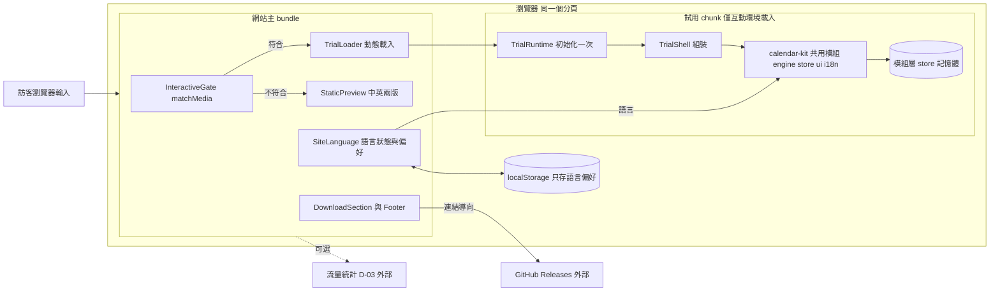
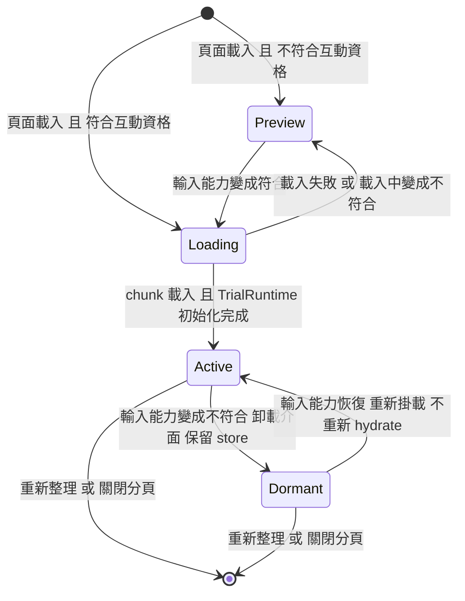

# 04 SAD — Juicy Landing Page

| 項目 | 內容 |
|---|---|
| 版本／狀態 | v0.1 **草稿**（待專案擁有者審查；未經審查前不開始實作） |
| 負責人／審查者 | 專案擁有者（使用者） |
| 日期 | 2026-11-09 |
| 上游 | `docs/01-brief.md`、`docs/02-prd.md` v0.5、`docs/03-srs.md` v0.4（皆草稿）。`diagrams/` 的流程圖依舊版 SRS 繪製，**已過期，只作參考，本文件不依賴它** |
| 下游 | `docs/05-sds.md`（契約與驗證情境） |
| 證據標示 | **【碼】** 讀過固定 commit 的原始碼；**【測】** 該 commit 有對應測試檔（未執行）；**【推】** 由程式碼推論；**【未】** 未驗證。固定基準：Calendar v0.2.0-beta.3，`102ae1917047aee691e88cef9c497b50df745c41`，下稱「基準」。本文件所有 Calendar 行為以 SRS 沿用登記表（`REUSE-nn`）為準，不另行定義 |
| 本階段限制 | 不修改 Calendar、不發布套件、不設定憑證、不新增套件、不寫程式。凡需要 Calendar 端改動的設計都標「Calendar 端改動」，屬提案，不是已核准 |

## 情境與品質驅動

**主要路徑**：進入首頁 → 判定互動資格 → （符合）載入試用並操作日曆 / （不符合）看靜態預覽 → 往下看下載區 → 前往 GitHub Releases。次要路徑：切換語言；頁尾看授權連結。

**資料敏感性**：沒有帳號、沒有伺服器端狀態。試用內容（區塊標題與時間）是訪客輸入，只存在分頁記憶體，**不得離開瀏覽器**（NFR-01）。語言偏好是唯一寫入瀏覽器儲存的資料。流量統計（D-03）是唯一可能出站的資料，內容不得含試用內容。

**故障影響**：試用載入失敗不影響下載區（下載是最終目標，G-01）；共用模組升級出錯會影響正式網站，所以升級要經 PR、測試與預覽（NFR-09）；快捷鍵攔截範圍過大會影響整頁（OR-26）。

**關鍵品質要求**：NFR-01 隱私、NFR-05 非互動環境不載入試用模組、NFR-09 版本化同步、AC-01.16 與 Calendar 行為一致、NFR-07 可近用限制明列。

**環境**：開發在本機（Windows，工具沿用實際路徑，程式、測試與 CI 不寫死機器絕對路徑）。預期部署為 Vercel 靜態站加 GitHub 原始碼庫，**本次部署不在範圍**；上線前缺口見「運作、風險與未決」。

## 元件與資料流

**信任邊界**（由外到內）：
1. 訪客輸入（指標、鍵盤、剪貼簿快捷鍵）：不可信，驗證由共用模組的 store 與引擎負責（名稱規則、長度規則，REUSE-04、REUSE-09）；網站不另訂驗證規則。
2. 瀏覽器環境訊號（`matchMedia`、`navigator.languages`）：可能缺失或拋例外，缺失一律當作「不符合」或「英文」。
3. `localStorage` 語言偏好：可被使用者或其他程式改寫，讀取時用 schema 驗證，不合法當作未設定。
4. 共用模組（Calendar 發布的程式碼）：供應鏈邊界，以確切版本與鎖定檔完整性雜湊管控（NFR-09）。
5. 外部連結（GitHub Releases）與流量統計：只出不入；不攜帶試用內容。
6. 輸出：標題等使用者資料由 React 以文字節點呈現（會跳脫）；`title` 屬性等也經 React 屬性，不使用 `dangerouslySetInnerHTML`【推】。實作時以測試輸入 `` 類標題驗證。

沿資料流說明：訪客操作 → 共用模組的手勢 hook 在本地狀態保存草稿，放開時才呼叫 store 的 action（一次手勢一個復原步驟，REUSE-05）→ store 更新記憶體並觸發重繪。網站**不啟動**桌面的持久化訂閱（`startPersistenceSync`），所以沒有任何寫出路徑。失敗回饋：Calendar 對無效操作不顯示訊息（REUSE-04、REUSE-09），網站不新增；網站自己的失敗（載入失敗、儲存失敗）見「故障模式」。

| 元件 | 責任／擁有資料 | 失敗時怎麼處理 |
|---|---|---|
| InteractiveGate | 以 `(pointer: fine) and (hover: hover)` 判定並訂閱變化（FR-08） | `matchMedia` 缺失或拋例外 → 視為不符合，顯示靜態預覽 |
| TrialLoader | 符合時動態載入試用 chunk，管理 載入中／已掛載／休眠／失敗（FR-08、NFR-05） | chunk 載入失敗 → 退回靜態預覽（失敗文案待確認，見待確認決策） |
| TrialRuntime | 初始化一次：語言橋接、`hydrate` 種子、`goToday()`（FR-01、FR-07） | 初始化丟例外 → 視為載入失敗；不留下半初始化狀態 |
| TrialShell | 組裝共用模組的元件：拖曳、日曆、球、覆蓋層、（待確認）radial（FR-01、FR-02） | 卸載時共用 hook 的清理負責停止手勢（REUSE-05） |
| calendar-kit（共用） | 日曆引擎、store、互動元件、i18n 字典（FR-02，所有 REUSE） | 規則錯誤由 Calendar 端修正並發布新版本 |
| memory store | 區塊、球、設定、復原歷史、選取、剪貼簿快照；模組層單例（FR-07） | 重新整理即清空，無恢復機制 |
| SiteLanguage | 網站語言狀態、偏好讀寫、橋接到共用 i18n（FR-10） | 儲存拋例外 → 本次工作階段仍生效，不保存，不顯示訊息 |
| StaticPreview | 中英兩版圖、替代文字、說明、「產品預覽」標示（FR-08） | 圖載入失敗 → 顯示替代文字與說明文字 |
| DownloadSection / Footer | 下載連結、限制說明、授權連結（FR-09、FR-15） | 外部站點不可用不在本站控制範圍 |
| 流量統計（可選） | 事件資料（D-03、OR-10 未決） | 載入失敗不得影響頁面 |

## 共用模組（calendar-kit）

名稱是占位，**待命名**。

### 邊界：什麼共用、什麼不共用

| 類別 | 內容 | 桌面 App | 網站 |
|---|---|---|---|
| 共用：引擎【碼】 | `engine/*`（時間換算、磁吸、變更函式、名稱規則、限制、過去日判斷、`detectLanguage`） | 使用 | 使用 |
| 共用：狀態【碼】 | `appStore`（事件、球、設定、復原歷史、選取、剪貼簿快照）與 schema | 使用 | 使用 |
| 共用：互動元件【碼】 | `CalendarGrid`（含右鍵選單、框選）、`EventBlock`、`TemplateBall`、`RadialPalette`、拖曳覆蓋層、手勢與快捷鍵 hooks | 使用 | 使用 |
| 共用：i18n【碼】 | 字典、`useT`、`initLanguage(backend)`、`setLanguage` | 使用 | 使用 |
| 共用：測試 | 引擎、store、元件與 e2e 測試；一致性案例資料（見「測試」） | 執行 | 執行同一版本的一致性案例 |
| 僅桌面 | `AppShell`、`WelcomeScreen`、`CalendarToolbar`、`Inspector`、`SettingsPage`、`Notices`、`workspaceSession`、`persistence/*`、Tauri `backend`、`TemplateEditor` | 使用 | **不引入** |
| 僅網站 | `InteractiveGate`、`TrialLoader`、`TrialRuntime`、`TrialShell`、`SiteLanguage`、`StaticPreview`、下載區、頁尾、metadata | — | 使用 |

### 共用接縫（OR-23；Calendar 端改動提案，待確認）

現況【碼】：元件與 hook 直接 import 單例 `useAppStore`；`backend` 是模組載入時依 `isTauri()` 決定的常數，且靜態 import `@tauri-apps/api/core`（`backend.ts:1,111`）；`i18n.ts` 預設參數 import 該 `backend`；`TemplatePalette` 把球、新增按鈕、工作區名稱與「切換工作區」寫在同一個元件；`AppShell` 把組裝寫在 App 內；`src/app/index.css` 含全域 `body { overflow: hidden }`、`#root { height: 100% }` 與全域按鈕、焦點樣式，同時也是元件用到的 Tailwind 主題來源。

| 接縫 | 要解決的問題 | 提案（預設行為 = 現行 App，不新增日曆功能） | 驗證 |
|---|---|---|---|
| S1 套件進入點 | 沒有可被別的專案依賴的邊界 | Calendar 專案改為 workspace，抽出單一套件，以子路徑匯出（`./engine`、`./store`、`./ui`、`./i18n`、`./styles`）；桌面 App 以同一套件建置 | Calendar 既有單元與 e2e 測試不改即全數通過（尚未執行） |
| S2 Tauri 與預設 backend 隔離 | 網站不應打包 Tauri 呼叫與桌面 backend | `i18n` 不再於模組載入時引入預設 backend（呼叫端傳入）；`backend.ts` 只被桌面進入點引入。`initLanguage(backend, …)` 已接受傳入 backend【碼】 | 網站建置產物搜尋不到 `@tauri-apps/api`、`invoke`；網站執行期 `localStorage` 只出現語言鍵 |
| S3 `TemplatePalette` 拆分 | 球列與工作區／編輯控制綁在一起（OR-20） | 匯出 `TemplateBall` 的純球列版本（`onEdit` 改為可省略，省略時名稱不是按鈕）；工作區名稱與切換、新增球留在桌面進入點 | 元件測試：省略 `onEdit` 時名稱為純文字；桌面行為不變 |
| S4 組裝 | 網站自己抄一份 `AppShell` 的組裝會與 App 漂移 | 匯出 `CalendarWorkbench`（拖曳、快捷鍵、日曆、球列、覆蓋層的組裝，具名插槽），桌面 `AppShell` 與網站 `TrialShell` 共用（ADR-03） | 桌面 e2e 不變；網站一致性案例 |
| S5 樣式 | 全域 `body` 樣式會破壞 landing page；元件依賴 Tailwind 類別 | 拆出 `./styles`：元件樣式與主題 token（以容器類別為作用域），全域重置留在桌面進入點；網站是否自行編譯 Tailwind 或使用預編譯 CSS：待實測 | 網站頁面捲動、按鈕、焦點樣式不被改變；試用區外無全域樣式洩漏 |
| S6 快捷鍵範圍 | `useKeyboardShortcuts` 在 `window` 上攔截 Ctrl+C／V／Z，`enabled=false` 時還攔截 Delete／Backspace 與所有 Ctrl／Cmd 組合（OR-26）【碼】 | 新增選用參數 `scope`（預設 `window`＝現行）；網站傳入試用容器（ADR-04） | 元件測試：scope 外按 Ctrl+C 不被 `preventDefault`；桌面預設不變 |
| S7 純語言偵測 | 網站主 bundle 要在不載入試用模組時偵測語言 | `./engine` 匯出不依賴 store 與 backend 的 `detectLanguage`；網站主 bundle 只引入這個函式 | 主 bundle 內容檢查：不含 store、dnd-kit |

**不需要改**【碼】：store 本身不 import 桌面 backend（只 import schema 與型別）；`hydrate(data, path)` 能用種子資料初始化（Calendar 自己的測試用它，`appStore.test.ts:1-21`）；`goToday()` 是公開 action；`initLanguage` 可傳入 backend。

### 桌面與網站的儲存接入

| 面向 | 桌面 App | 網站試用 |
|---|---|---|
| 區塊與球資料來源 | 開啟工作區資料夾，經 `WorkspaceBackend` 讀取（Tauri IPC 與 Rust） | `buildTrialWorkspace()` 產生種子資料，呼叫 `hydrate(data, 'memory:trial')` |
| 寫出 | `startPersistenceSync(backend)` 訂閱 store，把差異寫入檔案 | **不啟動**；沒有任何寫出路徑 |
| 復原歷史 | 在 store 記憶體，不寫檔 | 同左，另外在 UI 卸載時保留 |
| 語言偏好 | App 設定檔（`readAppSettings`／`writeAppSettings`） | `webLanguageBackend`：`localStorage` 一個鍵，讀取驗證，寫入失敗降級（OR-09 提案） |
| 錯誤顯示 | `Notices` 顯示儲存錯誤與載入問題 | 不掛載；網站沒有儲存錯誤 |
| `workspacePath` | 資料夾路徑 | 固定標記 `memory:trial`，只為了通過 store 內 `pasteCopied` 的 `workspacePath` 檢查【碼】 |

### 版本同步與回退

1. Calendar 修改共用行為 → Calendar 測試通過 → 發布新版本，發布說明標示 `[behavior]`（可觀察的共用規則變化）、`[api]`（介面變化）或 `[fix]`。語意化版本：不相容的行為或介面變化升主版號，向下相容的新增升次版號，修正升修訂號。
2. 網站開**升級 PR**：只改依賴版本、鎖定檔，並更新 SRS 沿用登記表的基準；**確切版本，不使用 `latest` 或範圍版本**。
3. 網站 CI：型別檢查、lint、單元測試、建置，加一致性案例（見「測試」）。
4. Vercel 預覽部署，人工依清單確認（建立、移動、調整、命名、刪除、復原、切換語言、模擬觸控環境、下載連結）。
5. 通過後合併並發布；未通過不得進入正式分支。
6. **回退**：還原升級 PR（鎖定檔、登記表一起回到上一版），經同一條 CI 重新建置；較快的路徑是 Vercel 還原先前部署，是否可用、有什麼限制**【未】未驗證**。因為除語言偏好外沒有持久資料，不需要資料遷移；語言偏好的值域固定（`zh-TW`、`en`）。
7. 版本追蹤：鎖定檔是權威版本；登記表的基準欄必須與之相同，由 CI 比對（提案，實作票決定檢查方式）。

### 發布管道與權限選項（OR-21；全部未核准）

| 選項 | 取得共用模組的方式 | 需要的權限 | 優點 | 代價與風險 |
|---|---|---|---|---|
| P1 | 私有的 npm 套件庫（例如 GitHub Packages） | CI 與 Vercel 各需一個可讀取套件的憑證 | 版本、完整性雜湊、鎖定檔流程標準 | 憑證管理；Calendar 端要建立發布流程。依我所知，讀取私有套件需要憑證【未】 |
| P2 | 以 git 標籤依賴 Calendar 私有 repository | 讀取該 repository 的部署金鑰或權杖 | 不需要套件庫 | 套件須在 repository 根目錄或有預建產物；npm 對子目錄套件的支援待實測【未】 |
| P3 | Calendar 的 Release 附上套件壓縮檔，網站以網址加完整性雜湊依賴 | 讀取私有 Release 的權杖 | 版本與產物明確 | 下載需權杖；流程自訂 |
| P4 | 公開的 npm 套件 | 無（讀取）；發布需帳號 | 網站建置無需憑證 | 公開 Calendar 程式碼，須先完成 LICENSE 與授權（D-10、R-14） |
| P5（後備） | 唯讀的快照同步腳本（原 D-08 複製方案的自動化版） | 無額外權限 | 最少依賴 | 要用 Vite alias 蓋掉 backend，脆弱；仍是兩份程式碼 |

**本 SAD 不核准任何一項，也不設定憑證。** 無論選哪一項，網站都以確切版本與完整性雜湊鎖定。選項差異影響的是 Calendar 端工作量與 Vercel 設定，不影響其餘設計。

### 升級 PR 是否自動建立（SAD 提案）

階段一（建議）：手動，由專案擁有者指定版本號，執行升級步驟並開 PR。階段二（發布管道選定且穩定後再評估）：排程或手動觸發的工作流程只**開 PR**，不自動合併；因為每次升級都要人工預覽確認。理由：目前沒有發布管道，也沒有網站 CI，自動化的前提不存在。

## UI 相依性（OR-20）

所有「相依」欄皆為【碼】（基準 commit 的 import 與組裝）。

| 排除項 | 所在元件 | 相依性結論 | 排除方式 | 影響 |
|---|---|---|---|---|
| 日期切換（前後、今天）、檢視切換、起訖時間、磁吸開關、縮放、設定入口 | 全在 `CalendarToolbar` | `CalendarGrid` 不 import 工具列；`AppShell` 才組裝它 | 不掛載 | 同時不顯示日期標題（`range-label`）；示範日靠日欄標題顯示；磁吸、縮放維持預設 |
| 設定頁 | `SettingsPage`，只由工具列開啟 | 無其他入口 | 不掛載 | 無 |
| 右側編輯面板 | `Inspector`，`AppShell` 組裝 | `CalendarGrid` 不 import；面板含的刪除、時間欄、顏色欄一併不存在 | 不掛載 | 日曆區全寬；右鍵選單仍可刪除、復原、重新命名（REUSE-07、REUSE-10） |
| 工作區管理與檔案存取 | `WelcomeScreen`、`workspaceSession`；`TemplatePalette` 內有工作區名稱與「切換工作區」 | 球列與工作區控制在同一個元件 | S3 拆分；或網站只用 `TemplateBall` 自組球列 | 不新增替代控制項 |
| 儲存錯誤與載入問題通知 | `Notices` | 依賴 `saveError`、`issues`，網站不會產生 | 不掛載 | 無 |
| 新增／編輯球（**待確認**） | `TemplatePalette` 的「＋」、`TemplateBall` 的名稱按鈕 → `TemplateEditor` | 編輯器會新增、改名、刪除球 | 見下 | 見下 |
| radial 選單（**待確認**） | `RadialPalette`，依賴球資料與拖曳 hook，無工作區或 Tauri 相依 | 長按空白處 250 ms 叫出（Calendar `RADIAL_LONG_PRESS_MS`）；與框選的觸發條件並存於 App | 不掛載或掛載 | 見下 |

**新增／編輯球：保留或排除的影響**（暫定排除，標示待確認）。

| | 排除（暫定） | 保留 |
|---|---|---|
| 與已核准需求 | 符合「三顆種子球」「不新增替代控制項」 | 訪客可新增、刪除、改名球，三顆種子球不再固定；球名稱屬使用者資料，無法限制語言 |
| 需要的改動 | S3：名稱不再是按鈕（否則是一個點了沒反應的按鈕）；或網站自組球列 | 需要把 `TemplateEditor` 與其依賴（顏色選擇器等）帶進試用 chunk |
| 驗證成本 | 少 | 多（模板刪除不影響區塊等行為，Calendar 有測試【測】`e2e/core.spec.ts:447`，網站要驗證接入後） |
| 靜態預覽 | 一致 | 預覽圖與互動版的球數可能不同 |

**radial 選單：保留或排除的影響**（暫定保留，標示待確認）。

| | 保留（暫定） | 排除 |
|---|---|---|
| 與「不新增 App 沒有的功能」 | 是 App 既有功能，且需要精細指標，符合互動資格 | 不掛載即可，但等於隱藏 App 功能 |
| 需要的改動 | 無（S4 組裝時掛載） | 無 |
| 驗證成本 | 多一個手勢要驗證：長按與框選並存、卸載時清除計時器（OR-24 情境 N-9） | 少 |
| 風險 | 長按觸發的計時器與選單在失去互動資格時需被清除【未】 | 無 |

## 狀態生命週期

- **狀態放置與卸載策略（設計提案，不預設放在試用模組外）**：store 是試用 chunk 內的模組層單例（ADR-02）。JavaScript 模組載入後不會被卸載，所以「卸載」指卸載 React 介面；store 因此自然保留區塊與復原歷史。重新整理建立新的模組實例，連同歷史一起清空。
- **初始化只做一次**：`TrialRuntime.ensureReady()` 在整個頁面生命週期內只執行一次初始化，之後的重新掛載不再呼叫 `hydrate`，否則會清掉區塊與歷史。
- **休眠期間**：沒有介面，也沒有任何 `window` 層級的快捷鍵與指標監聽（由共用 hook 的清理負責，需驗證，OR-24）。
- **載入中變成不符合**：丟棄掛載，不初始化；已初始化過的 store 不受影響。

## 故障模式與回饋

| 故障 | 偵測 | 使用者看到 | 資料 |
|---|---|---|---|
| `matchMedia` 缺失或拋例外 | 呼叫時 try／catch | 靜態預覽 | 無 |
| 試用 chunk 載入失敗（網路、版本更新） | 動態 import 被拒 | 靜態預覽；失敗專用文案**目前沒有需求依據**（待確認，見 Gate） | 無 |
| 初始化拋例外（例如種子資料不符 schema） | `ensureReady` 被拒 | 同上 | 保持未初始化，可重試一次 |
| `localStorage` 不可用（隱私模式、被封鎖） | try／catch | 語言仍可切換，本次工作階段有效；重新整理後回到瀏覽器語言規則；不顯示訊息 | 無 |
| 流量統計載入失敗 | 載入錯誤 | 無 | 無 |
| 手勢進行中失去互動資格 | 閘門變化 | 進行中的拖曳不產生區塊；已完成的資料與歷史保留 | 保留 |
| 命名進行中失去互動資格 | 閘門變化 | 沿用 App：卸載時提交輸入的名稱（REUSE-09）；實際結果待驗證（OR-24） | 依驗證結果 |
| 快捷鍵攔截範圍過大 | 驗證 Ctrl+C 複製頁面文字 | 若未做 S6：訪客在整頁無法用 Ctrl+C 複製（OR-26） | 無 |
| 頁面開著跨午夜 | 不偵測 | 示範日變成過去日並降低飽和度（REUSE-13，沿用 App） | 保留 |
| 共用模組升級帶入錯誤行為 | 一致性案例與預覽確認 | 升級 PR 不通過 | 無 |

## 測試與一致性驗證

**分層**（共用層優先，網站只驗證接入後行為，不重複測全部引擎）：

| 層 | 位置 | 內容 | 狀態 |
|---|---|---|---|
| A 引擎單元 | Calendar | 磁吸門檻、換算、名稱規則、限制；補門檻邊界值（OR-25） | 既有檔案存在【測】；補測待實作票 |
| B store 單元 | Calendar | 建立、命名、刪除、復原、重做；補 100 步上限、卸載與重新掛載不影響歷史 | 既有【測】；補測待實作票 |
| C 元件／e2e | Calendar | 手勢、右鍵選單、框選、剪貼簿、命名提交；補失焦與卸載提交、鍵盤層無選取按刪除、快捷鍵 `scope`（S6） | 既有【測】；補測待實作票 |
| D 一致性案例 | Calendar 定義，兩邊執行 | 同一組資料驅動案例，在 Calendar CI 與網站 CI 對**同一版本**執行並比對結果（AC-01.16）；格式見 SDS | 待實作 |
| E 網站整合 | 網站 | 閘門、載入／卸載／重掛載保留狀態、記憶體接入、語言橋接、隱藏 UI 不在 DOM、無 `localStorage` 寫入（語言鍵除外）、無網路請求攜帶區塊內容 | 待實作 |
| F 人工 | 預覽部署 | 升級清單；多瀏覽器；輔助技術不在範圍（NFR-07 已知限制） | 待實作 |

**OR-22（日期）測試設計**：目前日期有兩個系統時鐘來源（`anchor` 與 `useNow()`），皆不能注入參數【碼】，所以用假時鐘。單元：Vitest 假計時器固定系統時間後呼叫 `buildTrialWorkspace` 與 `goToday()`，斷言 `anchor` 為當日本地 00:00。e2e：Playwright `page.clock` 安裝假時鐘（Calendar 自己用同法，`e2e/core.spec.ts:639`【測】）；以 `timezoneId` 覆蓋時區邊界。斷言：兩個不同系統日期各顯示各自的日期；`fastForward` 跨午夜只斷言「不當機、區塊保留」，過去日降飽和是 App 行為，不當成網站需求斷言。

**OR-25（缺口）實作票驗證要求**：1. 在 Calendar 共用層補 `HISTORY_LIMIT`＝100 的 store 測試（第 101 個變更使最舊一步不可復原）。2. 補鍵盤層「無選取時按 Delete／Backspace 不改資料、不增加歷史」。3. 補 `EventBlock` 失焦與卸載時提交名稱的元件測試（也是 OR-24 的基礎）。4. 補磁吸門檻邊界值（距離 8 像素吸附、9 像素不吸附，換算見 SDS）。5. 網站只驗證：卸載後重掛載歷史仍在、同一版本的一致性案例通過。**「本次搜尋未找到」不等於「沒有」**，補測前先重新搜尋，已存在的不重複寫。

**測試隔離**：store 是單例，單元測試用 `hydrate`（Calendar 現有測試的做法【測】）或 `reset` 重置；e2e 每個案例重新載入頁面。互動資格的動態變化用可注入的 `matchMedia`（`MatchMediaFn`）做單元測試；e2e 以觸控裝置模擬驗證初次載入不載入試用 chunk。Playwright 在各引擎模擬 `pointer`／`hover` 的能力**【未】未驗證**，因此動態切換不依賴 e2e。NFR-06 的瀏覽器測試環境缺口（Safari 實機、各引擎）列為上線前缺口。

**需要的套件（全部待核准，本階段不新增）**：執行期：`react`、`react-dom`、共用模組及其對等依賴（`zustand`、`@dnd-kit/core`、`date-fns`、`zod`）；建置與測試：`vite`、`@vitejs/plugin-react`、`typescript`、`vitest`、`@playwright/test`、`eslint`；樣式視 S5 結果可能再加 Tailwind。版本在實作票確認相容性，不先鎖定。

## 重要決策與取捨

### ADR-01 共用模組的形式

決定：單一套件，以子路徑匯出（S1），放在 Calendar 專案的 workspace 內，桌面 App 與網站都依賴它。

考慮過：(a) 多個套件（engine／store／ui 分開發布）：邊界清楚，但每次修改要協調多個版本，對單人維護成本高。(b) 把整個 App 當函式庫：會帶入 Tauri 與工作區流程。(c) 兩個 repository 完全分開、複製程式碼：即原 D-08，漂移風險由人手同步承擔，已被取代。

影響與驗證：Calendar 端改動最大（S1～S7），可逆性中等（可退回現狀）；以「Calendar 既有測試不改即通過」驗證。

### ADR-02 狀態放置與卸載策略

決定：沿用基準的模組層單例 store；試用 chunk 載入後不卸載模組，只卸載 React 介面；初始化只做一次。

考慮過：(a) 以工廠建立每個實例的 store 並用 Provider 傳遞：隔離好，但基準有約二十個檔案直接 import `useAppStore`，改動大。(b) 休眠時序列化歷史、重新掛載時還原：可行，但快照式歷史要序列化整個事件表，複雜且容易與 App 偏離。(c) 把狀態搬到網站主 bundle：違反「非互動環境不載入試用模組」的精神且重複 store。

代價：整個頁面只能有一個試用實例；測試需要重置。影響與驗證：AC-01.10、AC-01.13 的歷史保留自然成立【推】，以整合測試驗證（SDS INV-03）。可逆性高。

### ADR-03 網站如何組裝共用元件

決定（待確認）：Calendar 匯出 `CalendarWorkbench`（S4），桌面與網站共用，組裝順序只有一份。

考慮過：網站自組 `TrialShell`，約抄 `AppShell` 的 30 行。優點是 Calendar 端不用重構 `AppShell`；缺點是 App 日後改了組裝（新增 hook、修正順序），網站不會同步，與「App 修改後網站同步」的目標衝突。若不接受 Calendar 端重構，以此為後備，並在一致性案例中加入 UI 層冒煙案例偵測漂移。

### ADR-04 快捷鍵攔截範圍（OR-26）

決定（待確認）：Calendar 端新增選用的 `scope`（S6），預設行為不變；網站把範圍限縮在試用容器，且容器內有焦點時才處理。

考慮過：(a) 網站只在滑鼠進入試用區時才掛載該 hook：不改 Calendar，但仍是 `window` 層級，訪客停留在試用區時 Ctrl+C 仍被攔截，且掛載頻繁。(b) 接受限制並在頁面說明：不需要改動，但影響整頁複製文字。選 `scope` 是因為它不新增日曆功能、預設不變、可用元件測試驗證。這個決定**不在 PRD／SRS 的需求內**，來自網站環境無法直接支援 App 的全域攔截（OR-26）。

### ADR-05 發布管道

見上節 P1～P5，**不決定**。

### ADR-06 升級 PR 自動化

見上節：階段一手動，階段二再評估；不自動合併。

## 運作、風險與未決

**部署不在範圍**：本次只設計，不連 Vercel、不新增 workflow、不發布套件、不設定憑證。若正式上線，需補：

| 缺口 | 內容 | 對應 |
|---|---|---|
| Vercel 連線與預覽保護 | 連線前確認預覽是否公開 | Brief R-11 |
| 授權 | `LICENSE`、`TRADEMARKS.md`、版權人與聲明文字；Calendar 來源授權 | D-10、R-14 |
| 共用模組取得方式與憑證 | P1～P5 擇一，憑證放哪裡、誰可輪替 | D-11、OR-21 |
| 網域 | 未定 | D-02 |
| 流量統計 | 工具與「開始試用」定義 | D-03、OR-10 |
| Windows 版驗證 | 影響下載區敘述 | D-04 |
| CI | GitHub Actions：型別檢查、lint、單元、建置、一致性案例；Vercel 不會自動等待 CI，阻擋機制需設計 | Brief「部署前檢查」 |
| 回退 | Vercel 還原先前部署是否可用 | NFR-09【未】 |
| 靜態預覽圖 | 要在互動版完成後才截，中英兩版 | R-13、OR-14 |
| 安全標頭 | 內容安全政策等未設計 | 上線前 |
| 瀏覽器測試環境 | 各引擎與 Safari 實機 | NFR-06 |
| 效能量測 | 門檻待量測 | NFR-05 |

**搜尋與分享 metadata（OR-18；SAD 提案，待確認，不阻擋本草稿）**：

| | 方案 M1（建議） | 方案 M2 |
|---|---|---|
| 初始 HTML | 單一頁面；`<html lang="zh-Hant">`，標題與描述用繁體中文，`og:locale` 繁中、`og:locale:alternate` 英文；語言切換後以腳本更新 `lang` 與 `title` | 兩個靜態頁（`/` 與 `/en/`），各有自己的 metadata |
| 代價 | 英文搜尋預覽看到中文；不增加頁面 | 內容重複、違反單頁決定、維護兩份 |
| 分享圖 | 使用實際運作的試用介面截圖（繁中版）；互動版完成前**不放占位或仿真圖** | 每種語言一張 |

**風險**：Calendar 端改動量大（S1～S7），若不被接受，ADR-03 與 ADR-04 需用後備方案，網站同步度下降；全域樣式洩漏（S5）可能影響整頁；供應鏈（共用模組）需要憑證與完整性管控；介面保留 App 的右鍵選單、框選與剪貼簿，驗證面較大。

## Gate：需求設計落點

| 需求 | 設計落點 |
|---|---|
| FR-01 | TrialShell、`buildTrialWorkspace`（SDS DATA-01～03）、UI 相依性表、示範日（OR-22） |
| FR-02 | calendar-kit（共用，所有 REUSE）、`CalendarWorkbench`（S4）、一致性案例（SDS CONF） |
| FR-07 | memory store、不啟動持久化、INV-01、INV-02、`webLanguageBackend`、網路與儲存斷言（E 層） |
| FR-08 | InteractiveGate、TrialLoader、StaticPreview、狀態生命週期、OR-24 情境 |
| FR-09 | DownloadSection（SDS UI-04、EXT-01） |
| FR-10 | SiteLanguage、S7、字典完整性檢查（SDS MOD-04） |
| FR-15 | Footer（SDS UI-05） |
| NFR-01 | 信任邊界、INV-01、E 層斷言 |
| NFR-02 | 站台字典完整性檢查；共用字典由 Calendar 自己的 `dictionary.test.ts`【測】；預覽圖人工檢查 |
| NFR-03 | 下載區敘述逐條對來源（人工），不在架構內 |
| NFR-04 | 版面（SDS UI-01）；具體寬度仍待定 |
| NFR-05 | 動態載入、主 bundle 範圍（S7）；效能門檻待量測 |
| NFR-06 | 測試環境缺口列表；Calendar 建置目標 `safari15`【碼】（`vite.config.ts`）；各瀏覽器實測未做 |
| NFR-07 | 已知限制清單（SRS）；網站自有控制項的鍵盤與替代文字（SDS UI-01～05） |
| NFR-08 | metadata 提案 M1／M2（OR-18） |
| NFR-09 | 版本同步與回退、發布管道選項、升級 PR 提案、鎖定與登記表比對 |
| AC-01.16 | 一致性案例（D 層） |

**未承接或僅部分承接的需求**：NFR-04 具體寬度；NFR-05 效能門檻；NFR-06 各瀏覽器實測；OR-10 統計事件；AC-02.3 完整驗收取決於 D-10。這些是需求端或實測缺口，不是設計遺漏。

**無需求依據的設計**（需確認保留或刪除）：
1. 試用載入失敗時的專用文案——PRD 與 SRS 沒有定義失敗文案；暫定退回靜態預覽且不加新文案。靜態預覽的說明「請使用電腦及滑鼠體驗互動試用」在載入失敗時可能誤導，待確認。
2. ADR-04 的 `scope`——來自網站環境限制（OR-26），尚無對應需求。
3. 版本發布說明的 `[behavior]`／`[api]`／`[fix]` 標示與鎖定檔對登記表的 CI 比對——由 NFR-09 衍生，屬流程設計。
4. 升級 PR 階段二自動化——屬提案。

**待確認決策**（不阻擋本草稿；標註是否阻擋實作或發布）：

| # | 決策 | 阻擋 |
|---|---|---|
| 1 | 是否同意 Calendar 端改動 S1～S7 的範圍（另案） | 實作 |
| 2 | ADR-03：`CalendarWorkbench` 共用，或網站自組 | 實作 |
| 3 | ADR-04／OR-26：`scope`，或接受限制 | 實作 |
| 4 | OR-20：新增／編輯球（暫定排除）與 radial 選單（暫定保留） | 實作 |
| 5 | OR-21／D-11：發布管道與權限 | 實作、發布 |
| 6 | 載入失敗文案 | 實作 |
| 7 | OR-18：metadata M1／M2 與分享圖 | 發布 |
| 8 | 套件清單核准 | 實作 |
| 9 | **已解決（2026-11-09）**：PRD v0.5.1 已把 AC-01.7 改為明確算例（10:00–12:00 的區塊、抓取偏移 20 分鐘、指標放開於 12:50 → 12:30–14:30，長度不變），不新增磁吸規則。原問題：PRD AC-01.7 的磁吸描述（同 AC-01.1 的精確度）尚未更新，本輪僅限 AC-01.1 | 已解除 |

## 變更紀錄

- **v0.1（2026-11-09，文件修正）**：待確認決策第 9 項標為已解決（PRD v0.5.1 對齊 AC-01.7）；其餘內容未變，仍為草稿。
